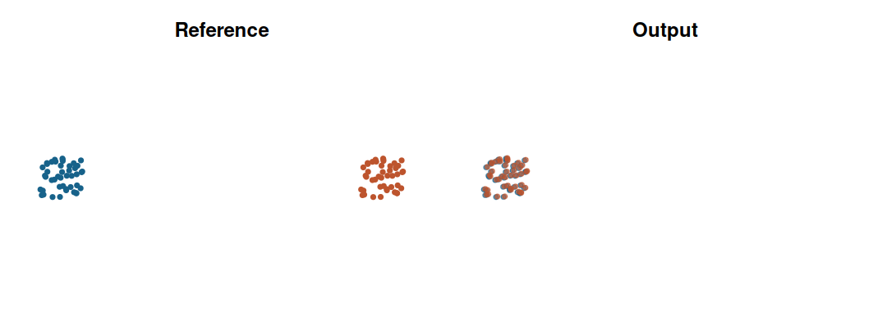

A single distance correlation averages over short and long distances. A distance-band profile
starts with nearby input pairs, then admits progressively more distant pairs. Each band reports
Spearman correlation for distance order and normalized stress for distance magnitudes after
fitting one multiplier.

## Preserve short distances and create false neighbors

Make two separated copies of an irregular cloud. In the output, move one copy almost on top of
the other without changing either copy’s internal distances.

```{r bands-data}
library(quadra)

set.seed(62)
cloud <- matrix(runif(90, -0.8, 0.8), ncol = 2)
group <- rep(c("A", "B"), each = nrow(cloud))
shift <- function(x, dx, dy) sweep(x, 2, c(dx, dy), "+")
x <- rbind(cloud, shift(cloud, 12, 0))
merged <- rbind(cloud, shift(cloud, 0.05, 0.02))
pairs <- t(combn(nrow(x), 2))
```

```{r bands-embeddings, eval=FALSE, fig.width=9, fig.height=3.4}
palette <- c(A = "#17628A", B = "#BD542D")
par(mfrow = c(1, 2), mar = c(2, 1, 3, 1))
vizier::embed_plot(
  x, colors = unname(palette[group]), title = "Reference",
  fixed_aspect = TRUE, show_axes = FALSE, xlim = c(-1, 13), ylim = c(-2, 2)
)
vizier::embed_plot(
  merged, colors = unname(palette[group]), title = "Output",
  fixed_aspect = TRUE, show_axes = FALSE, xlim = c(-1, 13), ylim = c(-2, 2),
  alpha_scale = 0.65
)
```

```{r show-bands-embeddings, echo=FALSE, out.width="100%", fig.alt="Two copies of a point cloud sit far apart in the input and overlap in the output."}

```

## Compare a fixed radius with all pairs

The radius of 2.5 includes every within-copy pair. The radius of 14 includes every pair in the
reference. Both results use the same exact pair list.

```{r bands-radius}
profile <- random_pair_distance_band_profile(
  x, merged, bands = c(2.5, 14), band_type = "radius", pairs = pairs
)
print(profile, digits = 3)

k <- 8
mean(nbr_pres(as.matrix(dist(x)), as.matrix(dist(merged)), k))
```

The near band preserves order and distances even though the merged clouds lose neighbors to
the other copy. The selection uses input distances, so those newly close pairs enter only at
larger input radii.

## Compare sampled and exact profiles

The default samples pairs with replacement. Pass one sampled pair list explicitly when comparing
embeddings. Here the exact list provides a check on the sampled profile.

```{r bands-sampling, fig.width=8, fig.height=3.8, fig.alt="Exact and sampled profiles agree closely. Spearman drops and stress rises as the bands admit between-copy pairs."}
set.seed(64)
sampled_pairs <- sample_pairs(nrow(x), 10000)
bands <- c(0.05, 0.2, 0.4, 0.55, 0.75, 1)
exact <- random_pair_distance_band_profile(x, merged, bands = bands, pairs = pairs)
sampled <- random_pair_distance_band_profile(x, merged, bands = bands, pairs = sampled_pairs)

par(mfrow = c(1, 2), mar = c(4, 4, 2, 1))
for (metric in c("spearman", "normalized_stress")) {
  title <- if (metric == "spearman") "Distance order" else "Fitted-scale stress"
  matplot(
    bands, cbind(exact[[metric]], sampled[[metric]]), type = "b",
    pch = c(1, 16), lty = c(1, 2), col = c("#174A77", "#AD4826"),
    xlab = "Requested input-pair fraction", ylab = title
  )
  legend(
    if (metric == "spearman") "topright" else "topleft",
    c("All unordered pairs", "Sampled pairs"), bty = "n",
    lty = c(1, 2), pch = c(1, 16), col = c("#174A77", "#AD4826")
  )
}
```

## Compress both clouds without moving their centers

This time keep each cloud’s center and shrink its offsets to one quarter. Fitting the scale inside
the near band removes that compression from the stress. Compare median within-cloud distance
to median all-pair distance to make the change in relative scale visible.

```{r bands-compression}
center <- colMeans(cloud)
small <- sweep(sweep(cloud, 2, center, "-") / 4, 2, center, "+")
compressed <- rbind(small, shift(small, 12, 0))
detail <- random_pair_distance_band_profile(
  x, compressed, bands = c(2.5, 14), band_type = "radius", pairs = pairs, ret_extra = TRUE
)
within <- group[detail$pairs[, 1]] == group[detail$pairs[, 2]]
relative_scale <- function(d) median(d[within]) / median(d)
round(c(input = relative_scale(detail$distance_in),
        output = relative_scale(detail$distance_out)), 3)
print(transform(detail$profile, fitted_scale = detail$fitted_scale), digits = 3)
```

The near band needs a multiplier of four to undo the within-cloud compression. The full band
needs a multiplier close to one because it includes the distances between the two centers.

## Whose distances enter a short band?

Give two groups the same number of observations. Spread the second copy of the cloud over a
larger area, then stretch that group horizontally and squeeze it vertically. Keep the dense
group fixed. A short input radius admits more pairs from the dense group.

```{r bands-density}
sparse <- 6 * cloud
reference <- rbind(cloud, shift(sparse, 20, 0))
changed <- rbind(cloud, shift(sweep(sparse, 2, c(2, 0.4), "*"), 20, 0))
radius <- 0.8
in_group <- group[pairs[, 1]] == group[pairs[, 2]]
plans <- list(Dense = pairs[in_group & group[pairs[, 1]] == "A", ],
              Sparse = pairs[in_group & group[pairs[, 1]] == "B", ],
              Pooled = pairs)
scores <- do.call(rbind, lapply(plans, function(plan) {
  random_pair_distance_band_profile(reference, changed, bands = radius,
                                    band_type = "radius", pairs = plan)
}))
# Every qualifying pair has both endpoints in the same group.
stopifnot(scores["Pooled", "n_pairs"] == sum(scores[c("Dense", "Sparse"), "n_pairs"]))
round(data.frame(points = c(nrow(cloud), nrow(cloud), nrow(reference)),
                 pairs = scores$n_pairs,
                 endpoint_share = scores$n_pairs / scores["Pooled", "n_pairs"],
                 stress = scores$normalized_stress, row.names = names(plans)), 3)
```

Each group has 45 observations, but 471 of the 488 qualifying pairs come from the dense group.
The sparse group's fitted-scale stress is 0.315. Pooling it with the unchanged dense group
reduces the reported stress to 0.124.

## Which observations account for the pooled error?

Use the one multiplier fitted to all 488 qualifying pairs. Split each pair's squared residual
equally between its endpoints and divide by the sum of squared input distances in the band.
Summing those allocations gives squared normalized stress. Keep the endpoint counts to see how
much evidence each observation contributes.

```{r bands-endpoints}
pooled <- random_pair_distance_band_profile(reference, changed, bands = radius,
  band_type = "radius", pairs = pairs, ret_extra = TRUE)
inside <- pooled$distance_in <= radius
din <- pooled$distance_in[inside]
residual <- din - pooled$fitted_scale * pooled$distance_out[inside]
half <- residual^2 / (2 * sum(din^2))
ends <- as.vector(pooled$pairs[inside, , drop = FALSE])
totals <- rowsum(rep(half, 2), ends)
allocated <- numeric(nrow(reference))
allocated[as.integer(rownames(totals))] <- totals[, 1]
incidents <- tabulate(ends, nrow(reference))
stopifnot(isTRUE(all.equal(sqrt(sum(allocated)), pooled$profile$normalized_stress)))

region <- factor(group, levels = c("A", "B"), labels = c("Dense", "Sparse"))
by_group <- split(seq_along(group), region)
round(t(vapply(by_group, function(i) {
  c(points_covered = sum(incidents[i] > 0), pair_ends = sum(incidents[i]),
    squared_error_share = sum(allocated[i]) / sum(allocated))
}, numeric(3))), 3)
top <- head(order(allocated, decreasing = TRUE), 5)
data.frame(row = top, group = region[top], incident_pairs = incidents[top],
           error_share = round(allocated[top] / sum(allocated), 3))
```

The stretched sparse group accounts for 94.1% of the squared error on only 34 of 976 pair ends.
The five largest allocations all belong to sparse points, each appearing in only one or two pairs.
Seventeen sparse points have no qualifying pair at this radius and hence no evidence about their
distortion here. The unchanged dense group contributes some error because the pooled multiplier
is 0.969.

For the fixed-radius approach, see [Takaeda's distance-band benchmark](https://arxiv.org/abs/2608.21779).
