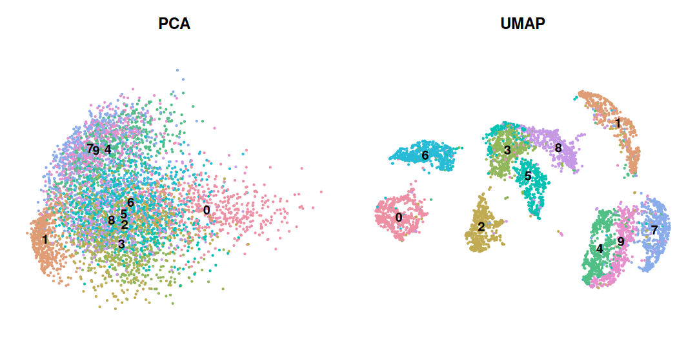
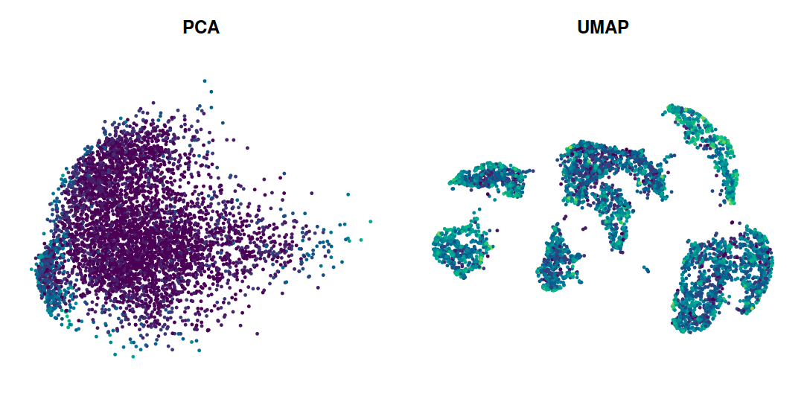
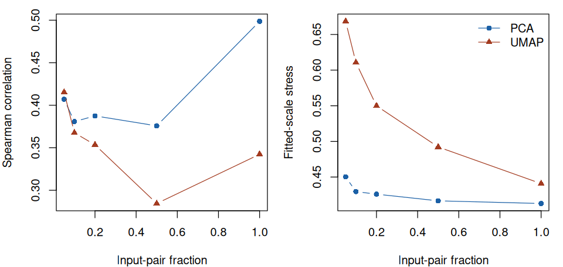
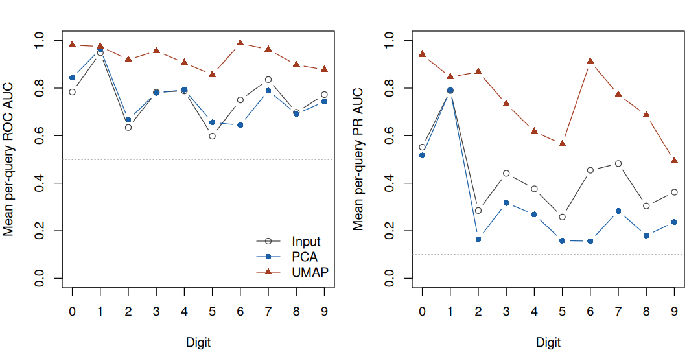
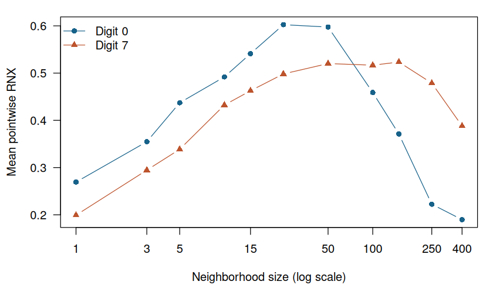
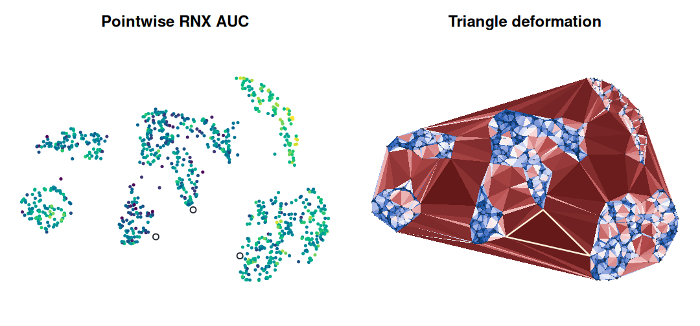

PCA and UMAP give different pictures of the same handwritten digits. Use one cohort and compare
which relationships each picture preserves.

## Load the digits

Install `quadra`, `uwot`, `PRROC`, `snedata`, and `vizier` before running the chunks. The latter
two are available from GitHub. For the band profile, install `quadra` from this checkout.

```{r mnist-install, eval=FALSE}
# Run once if the packages are missing:
# install.packages("pak")
# pak::pak(c("uwot", "PRROC",
#            "jlmelville/snedata", "jlmelville/vizier"))
```

```{r mnist-data, eval=FALSE}
library(quadra)

digits <- snedata::download_mnist(as = "list")
train <- split(which(digits$meta$split == "training"),
               digits$meta$label[digits$meta$split == "training"])
set.seed(413)
id <- sort(unlist(lapply(train, sample, size = 500), use.names = FALSE))
x <- digits$data[id, , drop = FALSE] / 255
label <- factor(digits$meta$label[id], levels = 0:9)
names(label) <- id
rm(digits)
```

## Fit and plot two embeddings

The 5,000 training images are balanced by digit. Both fits use the same pixels on a 0–1 scale,
with no per-pixel standardization.

```{r mnist-fit, eval=FALSE}
pca <- prcomp(x, rank. = 2)$x
set.seed(414)
umap <- uwot::umap(
  x, n_neighbors = 15, min_dist = 0.1, n_threads = 1, n_sgd_threads = 1
)
maps <- list(PCA = pca, UMAP = umap)
```

```{r mnist-embeddings, eval=FALSE, fig.width=9, fig.height=4.5}
digit_colors <- setNames(grDevices::hcl.colors(10, "Set 2"), levels(label))
par(mfrow = c(1, 2), mar = c(1, 1, 3, 1))
for (method in names(maps)) {
  xy <- maps[[method]]
  vizier::embed_plot(
    xy, colors = unname(digit_colors[as.character(label)]),
    title = method, fixed_aspect = TRUE, show_axes = FALSE, cex = 0.5
  )
  centers <- aggregate(xy, list(digit = label), median)
  text(centers[[2]], centers[[3]], centers$digit, font = 2)
}
```

```{r show-mnist-embeddings, echo=FALSE, out.width="100%", fig.alt="PCA mixes most digits in one cloud. UMAP separates many digits into islands."}

```

## Compare neighbors and distances on all 5,000 rows

Reuse the original-space neighbor graph, pair sample, and triplet sample across both embeddings.
Look at several neighborhood sizes, including UMAP’s fitting scale of 15.

```{r mnist-full, eval=FALSE}
set.seed(415)
pairs <- sample_pairs(nrow(x), 20000)
triplets <- sample_triplets(nrow(x), 5)
k <- c(5, 15, 50)
set.seed(416)
pca_nn <- nn_preservation(x, pca, k = k, n_threads = 1, ret_extra = TRUE)
umap_nn <- nn_preservation(
  pca_nn$nn_in, umap, k = k, n_threads = 1, ret_extra = TRUE
)
scores <- function(y, nn) {
  c(
    nn$nnp,
    pair_spearman = random_pair_distance_correlation(
      x, y, pairs = pairs, method = "spearman", n_threads = 1
    ),
    triplet_accuracy = random_triplet_accuracy(
      x, y, triplets = triplets, n_threads = 1
    )
  )
}
round(rbind(PCA = scores(pca, pca_nn), UMAP = scores(umap, umap_nn)), 3)
```

```text
      nnp5 nnp15 nnp50 pair_spearman triplet_accuracy
PCA  0.028 0.056 0.115         0.499            0.671
UMAP 0.257 0.341 0.426         0.342            0.619
```

```{r mnist-overlap, eval=FALSE, fig.width=9, fig.height=4.5}
par(mfrow = c(1, 2), mar = c(1, 1, 3, 1))
local_scores <- list(PCA = pca_nn$nnpv$nnp15, UMAP = umap_nn$nnpv$nnp15)
for (method in names(maps)) {
  vizier::embed_plot(
    maps[[method]], x = local_scores[[method]], color_scheme = "grDevices::Viridis",
    limits = c(0, 1), title = method, fixed_aspect = TRUE, show_axes = FALSE, cex = 0.6
  )
}
```

```{r show-mnist-overlap, echo=FALSE, out.width="100%", fig.alt="UMAP has more green and yellow points than PCA on the shared neighbor-overlap scale."}

```

Each point is colored by its fraction of retained neighbors at `k = 15`. Both panels use a
0–1 scale from purple to yellow.

## Compare short and long distances

Use the same pair sample to ask whether each method preserves short distances better than the
dataset-wide score suggests. The input-pair fractions are cumulative.

```{r mnist-bands, eval=FALSE, fig.width=8, fig.height=3.8}
bands <- c(0.05, 0.1, 0.2, 0.5, 1)
profiles <- lapply(maps, function(y) {
  random_pair_distance_band_profile(x, y, bands = bands, pairs = pairs)
})

par(mfrow = c(1, 2), mar = c(4, 4, 1, 1))
for (metric in c("spearman", "normalized_stress")) {
  title <- if (metric == "spearman") "Spearman correlation" else "Fitted-scale stress"
  values <- vapply(profiles, function(profile) profile[[metric]], numeric(length(bands)))
  matplot(
    bands, values, type = "b", pch = c(16, 17), lty = 1,
    col = c("#1B60A6", "#A33B20"), xlab = "Input-pair fraction", ylab = title
  )
  if (metric == "normalized_stress") legend(
    "topright", names(profiles), col = c("#1B60A6", "#A33B20"),
    pch = c(16, 17), lty = 1, bty = "n"
  )
}
```

```{r show-mnist-bands, echo=FALSE, out.width="100%", fig.alt="PCA has lower fitted-scale stress at all shown fractions and higher full-band Spearman."}

```

PCA has lower fitted-scale stress at each displayed band. It also has higher full-band
Spearman correlation, while UMAP retains more of the actual nearest neighbors.

## Audit ranks and labels on a fixed subset

One dense double distance matrix for 5,000 observations uses about 191 MiB before temporaries.
Use 100 observations per digit here, so each matrix uses about 7.6 MiB. All dense diagnostics
below describe this subset and its candidate neighbors.

```{r mnist-audit, eval=FALSE}
set.seed(417)
audit <- sort(unlist(lapply(split(seq_along(label), label), sample, size = 100)))
audit_label <- label[audit]
distance <- function(z) as.matrix(dist(z[audit, , drop = FALSE]))
din <- distance(x)
dout <- lapply(maps, distance)
rank_scores <- t(vapply(dout, function(d) {
  c(
    trustworthiness = trustworthiness(din, d, k = 15),
    continuity = continuity(din, d, k = 15),
    rnx_auc = rnx_auc(din, d)
  )
}, numeric(3)))
round(rank_scores, 3)
```

```text
     trustworthiness continuity rnx_auc
PCA            0.742      0.884   0.173
UMAP           0.942      0.916   0.340
```

```{r mnist-labels, eval=FALSE, fig.width=9, fig.height=4.5}
spaces <- c(list(Input = din), dout)
roc <- lapply(spaces, function(d) roc_auc(d, audit_label))
pr <- lapply(spaces, function(d) pr_auc(d, audit_label))
overall <- function(x) vapply(x, function(z) z$av_auc, numeric(1))
round(rbind(ROC = overall(roc), PR = overall(pr)), 3)

par(mfrow = c(1, 2), mar = c(4, 4, 2, 1))
series_colors <- c("#404040", "#1B60A6", "#A33B20")
series_symbols <- c(1, 16, 17)
retrieval <- list("ROC AUC" = roc, "PR AUC" = pr)
for (metric in names(retrieval)) {
  by_digit <- vapply(retrieval[[metric]], function(z) {
    unlist(z$label_av)[levels(label)]
  }, numeric(10))
  matplot(
    0:9, by_digit, type = "b", lty = 1, pch = series_symbols,
    col = series_colors, xaxt = "n", ylim = c(0, 1),
    xlab = "Digit", ylab = paste("Mean per-query", metric)
  )
  axis(1, 0:9)
  baseline <- if (metric == "ROC AUC") 0.5 else 99 / 999
  abline(h = baseline, col = "grey50", lty = 3)
  if (metric == "ROC AUC") legend(
    "bottomright", colnames(by_digit), col = series_colors, pch = series_symbols,
    lty = 1, bty = "n"
  )
}
```

```text
    Input   PCA  UMAP
ROC 0.759 0.757 0.932
PR  0.431 0.307 0.743
```
```{r show-mnist-labels, echo=FALSE, out.width="100%", fig.alt="UMAP gives higher per-digit ROC and PR AUC than input pixels and PCA for every digit."}

```

The dotted lines mark random retrieval. Each query has 99 same-label candidates out of 999. A higher
PR AUC in the embedding means same-label images become easier to retrieve. Compare that gain
with fidelity to the original pixels before interpreting visually separated digits.

## Compare neighborhood sizes for each point

At a fixed size, pointwise RNX is overlap adjusted for chance. Use several sizes to see
whether agreement holds as each point's neighborhood grows. The AUC averages the complete
curve with weight `1 / k` for each size.

```{r mnist-pointwise-rnx, eval=FALSE}
sizes <- c(1, 3, 5, 10, 15, 25, 50, 100, 150, 250, 400)
umap_rnx <- pointwise_rnx(din, dout$UMAP, k = sizes)
umap_penalties <- pointwise_rank_preservation(din, dout$UMAP, k = 15)
digits_of_interest <- c("0", "7")
digit_curves <- vapply(digits_of_interest, function(digit) {
  colMeans(umap_rnx$curve[audit_label == digit, , drop = FALSE])
}, numeric(length(sizes)))
digit_summary <- t(vapply(digits_of_interest, function(digit) {
  keep <- audit_label == digit
  c(digit_curves[c("rnx15", "rnx100", "rnx250"), digit],
    auc = mean(umap_rnx$auc[keep]),
    trustworthiness15 = mean(umap_penalties$trustworthiness[keep, 1]),
    continuity15 = mean(umap_penalties$continuity[keep, 1]))
}, numeric(6)))
round(digit_summary, 3)
```

```text
  rnx15 rnx100 rnx250   auc trustworthiness15 continuity15
0 0.541  0.459  0.222 0.369             0.968        0.956
7 0.463  0.517  0.479 0.395             0.959        0.948
```

```{r mnist-pointwise-rnx-plot, eval=FALSE, fig.width=7, fig.height=4.1}
colors <- c("#17628A", "#BD542D")
par(mar = c(4.3, 4.3, 1.2, 1.1), las = 1)
matplot(
  sizes, digit_curves, type = "b", log = "x", xaxt = "n", pch = c(16, 17), lty = 1,
  col = colors, xlab = "Neighborhood size (log scale)", ylab = "Mean pointwise RNX"
)
axis(1, at = c(1, 3, 5, 15, 50, 100, 250, 400))
legend("topleft", paste("Digit", digits_of_interest), col = colors, pch = c(16, 17),
       lty = 1, bty = "n")
```

```{r show-mnist-pointwise-rnx, echo=FALSE, out.width="100%", fig.alt="The mean RNX for digit 0 is higher at small k. Digit 7 leads at k of 100 and 250."}

```

At `k = 15`, 0s have higher mean overlap, trustworthiness, and continuity than 7s in this
UMAP audit. At `k = 100` and `250`, 7s have higher mean RNX. The change in ordering between
those sizes also appeared on audit subsets drawn with seeds 418 and 419. Their AUCs were close
enough for the ordering to vary across the three subsets, so the curves show the difference
more clearly.

## Check distance ordering from each anchor

Use the same 1,000 audit rows and the same 512 sampled comparisons per anchor for both
embeddings. For each anchor, ask whether the closer of two sampled observations stays closer.
The summary counts input-distance ties as sampled comparisons and excludes them from accuracy.

```{r mnist-anchor-triplets, eval=FALSE}
set.seed(421)
anchor_triplets <- sample_triplets(length(audit), n_triplets = 512)
pca_rnx <- pointwise_rnx(din, dout$PCA)$auc
anchor_results <- lapply(maps, function(y) {
  random_triplet_accuracy(
    x[audit, , drop = FALSE], y[audit, , drop = FALSE],
    triplets = anchor_triplets, by_anchor = TRUE, n_threads = 1
  )
})
change_rnx <- umap_rnx$auc - pca_rnx
change_triplets <- anchor_results$UMAP$by_anchor$accuracy - anchor_results$PCA$by_anchor$accuracy
round(c(rnx_auc = mean(change_rnx > 0), triplet_accuracy = mean(change_triplets > 0)), 3)
```

```text
         rnx_auc triplet_accuracy
           0.894            0.291
```

```{r mnist-anchor-triplets-plot, eval=FALSE, fig.width=6.8, fig.height=4.4}
par(mar = c(4.4, 4.5, 1.1, 1.1), las = 1)
plot(
  change_rnx, change_triplets, type = "n",
  xlab = "RNX AUC difference (UMAP minus PCA)",
  ylab = "Triplet accuracy difference (UMAP minus PCA)"
)
abline(v = 0, h = 0, col = "grey65", lty = 2)
is_one <- audit_label == "1"
points(change_rnx[!is_one], change_triplets[!is_one], pch = 16, cex = 0.64, col = "#61768C70")
points(change_rnx[is_one], change_triplets[is_one], pch = 17, cex = 0.78, col = "#A33B20")
legend(
  "topright", c("Other digits", "Digit 1"), pch = c(16, 17),
  col = c("#61768C", "#A33B20"), bty = "n"
)
```

```{r show-mnist-anchor-triplets, echo=FALSE, out.width="100%", fig.alt="A scatterplot of the two metrics shows many anchors, including digit 1, with higher RNX AUC in UMAP and higher triplet accuracy in PCA."}
knitr::include_graphics("figures/mnist-anchor-triplets.png")
```

UMAP leads for about 89% of the anchors by RNX AUC and 29% by triplet accuracy. The lower
right shows anchors whose neighborhoods agree better under UMAP while their distance ordering
favors PCA. Many 1s show this tradeoff. On this audit subset it persists when the triplets
are redrawn with seeds 422 and 423.

## Compare pairs of digits

Recompute ROC and PR AUC with candidates restricted to each pair of digits. Use the same audit
rows in all three spaces. Then compare distance consistency, the fraction of observations
nearer their own digit centroid than the other digit's centroid, with half credit for ties.

```{r mnist-class-pairs, eval=FALSE}
label_results <- lapply(maps, function(y) {
  label_trustworthiness_continuity(
    x[audit, , drop = FALSE], y[audit, , drop = FALSE], audit_label, ret_extra = TRUE
  )
})
round(t(vapply(label_results, function(result) result$scores, numeric(2))), 3)

class_pairs <- label_results[[1]]$pairs[, c("label_a", "label_b")]
pair_name <- apply(class_pairs, 1, function(classes) paste(sort(classes), collapse = "/"))
pair_auc <- function(dm) {
  t(vapply(seq_len(nrow(class_pairs)), function(i) {
    keep <- audit_label %in% unlist(class_pairs[i, ], use.names = FALSE)
    pair_dm <- dm[keep, keep]
    c(ROC = roc_auc(pair_dm, audit_label[keep])$av_auc,
      PR = pr_auc(pair_dm, audit_label[keep])$av_auc)
  }, numeric(2)))
}
input_auc <- pair_auc(din)
changes <- Map(function(dm, result) {
  data.frame(pair = pair_name, pair_auc(dm) - input_auc, DSC = result$pairs$change)
}, dout, label_results)

highlight <- c(PCA = "5/9", UMAP = "2/8")
example_changes <- do.call(rbind, lapply(names(changes), function(method) {
  transform(subset(changes[[method]], pair == highlight[[method]]), method = method)
}))
print(example_changes[, c("method", "pair", "ROC", "PR", "DSC")], digits = 3, row.names = FALSE)
```

```text
     trustworthiness continuity
PCA            0.874      1.000
UMAP           0.997      0.988
 method pair    ROC     PR    DSC
    PCA  5/9 0.0715 0.0282 -0.095
   UMAP  2/8 0.2263 0.2049 -0.005
```

```{r mnist-pair-plot, eval=FALSE, fig.width=8, fig.height=4.2}
xlim <- range(0, unlist(lapply(changes, function(d) d$PR))) + c(-0.03, 0.05)
ylim <- range(0, unlist(lapply(changes, function(d) d$DSC))) + c(-0.02, 0.02)
par(mfrow = c(1, 2), mar = c(4.2, 4.2, 2.2, 0.8), las = 1)
for (method in names(changes)) {
  d <- changes[[method]]
  plot(
    d$PR, d$DSC, type = "n", xlim = xlim, ylim = ylim, main = method,
    xlab = "Change in pairwise PR AUC", ylab = "Change in distance consistency"
  )
  abline(h = 0, v = 0, col = "grey65", lty = 2)
  points(d$PR, d$DSC, pch = 16, col = "#506579")
  chosen <- d[d$pair == highlight[[method]], ]
  points(chosen$PR, chosen$DSC, pch = 17, col = "#A33B20", cex = 1.3)
  text(chosen$PR, chosen$DSC, chosen$pair, pos = 4, col = "#A33B20")
}
```

```{r show-mnist-class-pairs, echo=FALSE, out.width="100%", fig.alt="Changes in PR AUC and centroid consistency for all 45 digit pairs. PCA raises PR AUC for 5 and 9 while lowering centroid consistency. UMAP raises PR AUC for 2 and 8 while centroid consistency stays near its reference value."}
knitr::include_graphics("figures/mnist-class-pairs.png")
```

PCA makes 5s and 9s easier to retrieve even as their centroid consistency falls from 0.950 to
0.855. Across three balanced audit subsets (seeds 417–419) of the same embeddings, their PR AUC
rose by 0.028–0.044 and consistency fell by 0.080–0.095. UMAP shows a different pattern for 2s
and 8s. Their PR AUC rises by about 0.2 in all three subsets, with little room for improvement
in the already high input consistency.

Label trustworthiness averages decreases in consistency as penalties. Label continuity penalizes
increases relative to the input, including cases where the embedding makes a pair of digits look
more separated around their centroids. Use the per-pair changes to inspect what drives each score.
[Label retrieval guide](label-retrieval.html#compare-centroid-separation)

## Compare angular spread from each digit

Class Angular Distortion Index (CADI) compares the angle from one observation to two observations
of another class. For each triplet, it squares the change in cosine and divides by four. Use one
sample for both embeddings. Lower values mean better angular preservation.
[Gunaratne et al.](https://arxiv.org/abs/2605.00637)

```{r mnist-cadi, eval=FALSE}
set.seed(426)
angle_triplets <- sample_class_triplets(audit_label, n_triplets = 90000)
angular <- lapply(maps, function(y) {
  class_angular_distortion_index(
    x[audit, , drop = FALSE], y[audit, , drop = FALSE], audit_label,
    triplets = angle_triplets, ret_extra = TRUE
  )
})
round(vapply(angular, function(result) result$cadi, numeric(1)), 3)

directions <- data.frame(anchor = c("3", "5"), endpoints = c("5", "3"))
pair_scores <- vapply(angular, function(result) {
  pair <- result$pairs
  rows <- match(paste(directions$anchor, directions$endpoints),
                paste(pair$anchor_class, pair$endpoint_class))
  pair$cadi[rows]
}, numeric(nrow(directions)))
print(cbind(directions, round(pair_scores, 3)), row.names = FALSE)
```

```text
 PCA UMAP
0.05 0.04
 anchor endpoints   PCA  UMAP
      3         5 0.075 0.118
      5         3 0.056 0.040
```

```{r mnist-cadi-plot, eval=FALSE, fig.width=9, fig.height=4.2}
angle_change <- lapply(angular, function(result) {
  (acos(result$cosine_out) - acos(result$cosine_in)) * 180 / pi
})
anchor <- audit_label[angle_triplets[, 1]]
endpoints <- audit_label[angle_triplets[, 2]]
colors <- c(PCA = "#1B60A6", UMAP = "#A33B20")
xlim <- range(unlist(angle_change, use.names = FALSE))

par(mfrow = c(1, 2), mar = c(4.3, 4.4, 2.3, 0.7), las = 1)
for (i in seq_len(nrow(directions))) {
  keep <- anchor == directions$anchor[i] & endpoints == directions$endpoints[i]
  cdfs <- lapply(angle_change, function(change) ecdf(change[keep]))
  plot(
    cdfs$PCA, col = colors["PCA"], lwd = 2, do.points = FALSE, verticals = TRUE,
    xlim = xlim, ylim = c(0, 1),
    main = paste("From digit", directions$anchor[i], "to digit", directions$endpoints[i]),
    xlab = "Embedding angle minus input angle (degrees)", ylab = "Cumulative fraction"
  )
  lines(cdfs$UMAP, col = colors["UMAP"], lwd = 2, do.points = FALSE, verticals = TRUE)
  abline(v = 0, col = "grey55", lty = 2)
  if (i == 1) legend("bottomright", names(colors), col = colors, lty = 1, lwd = 2, bty = "n")
}
```

```{r show-mnist-cadi, echo=FALSE, out.width="100%", fig.alt="Cumulative distributions of signed angle changes for both directions between 3s and 5s. UMAP both widens and narrows angles substantially from 3s to pairs of 5s. In the reverse direction, the changes are mostly narrowing."}
knitr::include_graphics("figures/mnist-cadi.png")
```

In this audit, UMAP improves PR AUC for 3s and 5s by 0.062 relative to the input, while their
nearest-centroid consistency drops by 0.015. Those scores summarize the pair. CADI shows that
angles from 3s to pairs of 5s change much more in UMAP than in PCA or in the reverse direction.
The figure shows both widening and narrowing from 3s to 5s. From 5s to 3s, UMAP mostly narrows
the angles shown here.

Across audit seeds 417–419, 3-to-5 is UMAP's highest-distortion direction among all 90
directed digit pairs. It scores 0.118–0.132, versus 0.040–0.051 for 5-to-3. UMAP has lower
overall CADI than PCA in each audit.

## Inspect the gaps between digits

Gap Index colors each empty triangle in the embedding by how much its share of the total
triangle area changes. This comparison uses the same 1,000 audit rows and requires the
`geometry` package.

```{r mnist-gap-index, eval=FALSE}
gap_results <- lapply(maps, function(y) {
  gap_index(x[audit, , drop = FALSE], y[audit, , drop = FALSE], ret_extra = TRUE)
})
round(vapply(gap_results, function(result) result$gap_index, numeric(1)), 3)

umap_gap <- gap_results$UMAP
largest <- which.max(umap_gap$relative_area_out - umap_gap$relative_area_in)
vertices <- umap_gap$triangles[largest, ]
sort(as.character(audit_label[vertices]))
round(100 * c(input = umap_gap$relative_area_in[largest],
              embedding = umap_gap$relative_area_out[largest]), 2)
```

```text
  PCA  UMAP
0.644 0.739
[1] "2" "4" "5"
    input embedding
     0.09      3.45
```

```{r mnist-gap-map, eval=FALSE, fig.width=9, fig.height=4.2}
xy <- maps$UMAP[audit, , drop = FALSE]
triangle_rows <- c(t(cbind(umap_gap$triangles, NA_integer_)))
colors <- hcl.colors(101, "Blue-Red 3")
fill <- colors[round(50 * (1 + umap_gap$deformation)) + 1L]

par(mfrow = c(1, 2), mar = c(0.6, 0.6, 2.7, 0.6))
vizier::embed_plot(
  xy, x = umap_rnx$auc, color_scheme = "grDevices::Viridis",
  title = "Pointwise RNX AUC", fixed_aspect = TRUE, show_axes = FALSE, cex = 0.65
)
points(xy[vertices, , drop = FALSE], pch = 21, bg = "white", col = "#20262F", lwd = 1.5)

plot(xy, type = "n", asp = 1, axes = FALSE, xlab = "", ylab = "", main = "Triangle deformation")
polygon(xy[triangle_rows, 1], xy[triangle_rows, 2], col = fill, border = NA)
points(xy, pch = 16, cex = 0.28, col = "#20262F90")
polygon(xy[vertices, , drop = FALSE], border = "#FFF2D9", lwd = 2)
```

```{r show-mnist-gap-index, echo=FALSE, out.width="100%", fig.alt="The pointwise UMAP map marks three vertices. The triangle map fills the gap among them and outlines it in white."}

```

The outlined triangle between 2s, 4s, and 5s grows from about 0.09% of reference triangle
area to 3.45% of the area on the UMAP plot. It spans the same digit groups for the other
audit seeds, 418 and 419. The pointwise map marks its vertices. The regional map shows how
much space opens between them. Red means expansion and blue means compression.

The triangles fill the convex hull. Their areas describe this sampled scatterplot, including
its boundary. [Gap Index paper](https://arxiv.org/abs/2607.28324)
