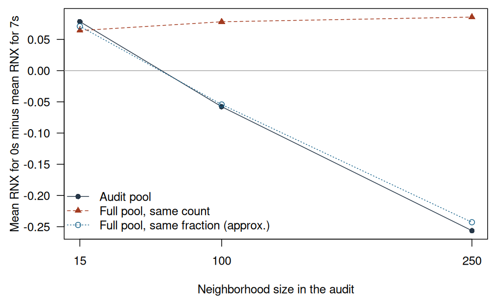
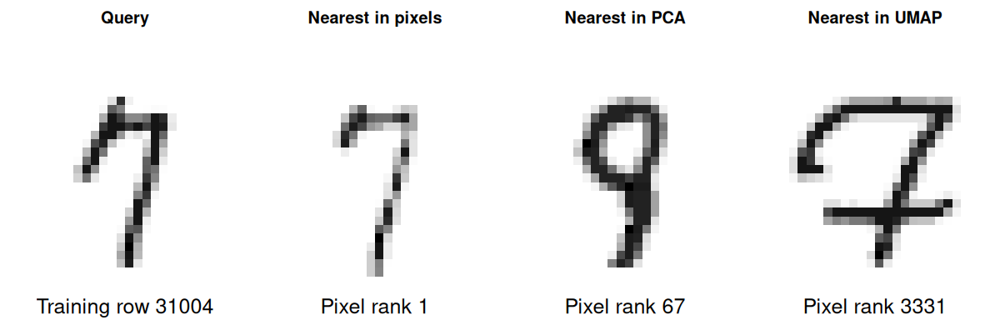
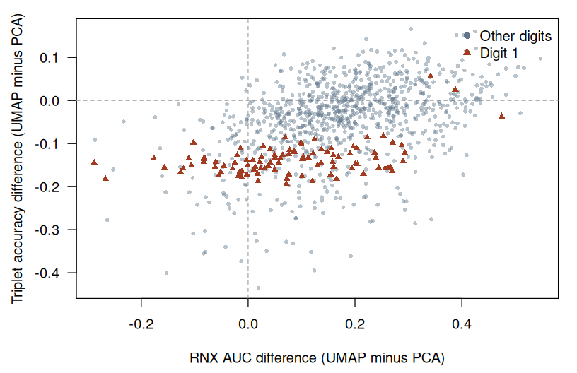
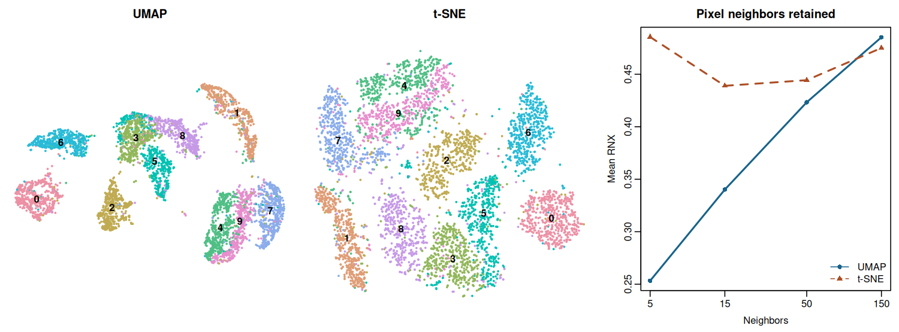
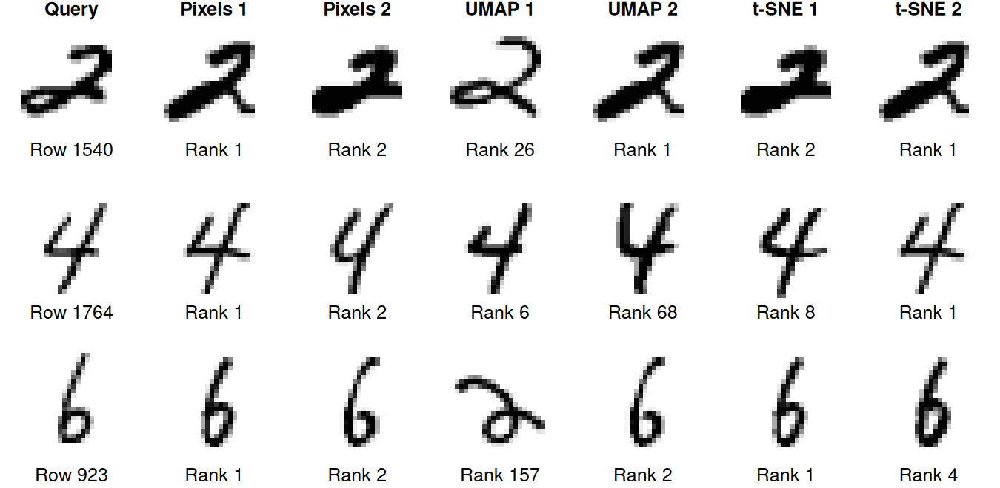
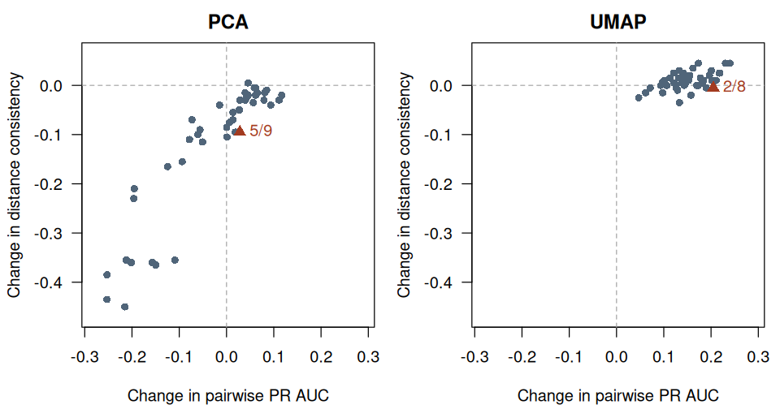
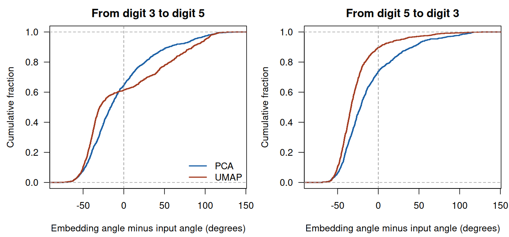
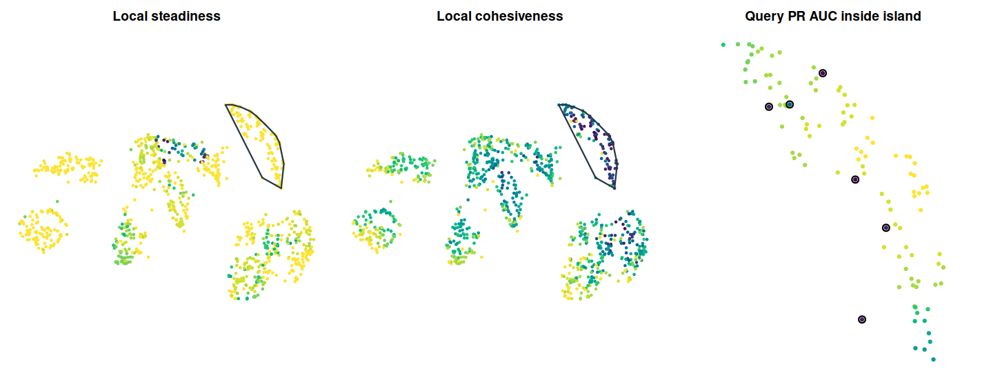

## Which embedding would you use?

We start with PCA and UMAP fitted to the same 5,000 handwritten digits, then bring in t-SNE for
a closer look at the neighbors. Which map you would use depends on what you want to read from it.

- **Can I trust the nearest images?** UMAP keeps 34% of the 15 closest pixel neighbors on average,
  compared with 6% for PCA. For one handwritten 7, though, UMAP's nearest image ranks 3,331st in
  pixel space. [Inspect the two nearest images](#inspect-the-closest-neighbors-within-the-first-15).
- **Does keeping more neighbors help me find the same digit?** For 414 of the 1,000 queries, t-SNE
  kept more pixel neighbors but UMAP did better at retrieving the digit across the full ranking.
  [Look at the handwritten 2, 4 and 6 and their neighbors](#umap-versus-tsne).
- **Would an exact search or a larger candidate pool change the answer?** UMAP keeps its lead on
  the [exact-search spot check](#spot-check-the-pixel-neighbor-search). In UMAP, 0s keep more of
  their pixel neighbors at small neighborhood sizes, while 7s keep more at larger sizes.
  [Compare the same queries in both candidate pools](#expand-the-candidate-pool-to-all-5000-images).
- **Can I compare distances between arbitrary images?** PCA preserves more sampled triplet
  orderings (67% versus 62%) and has lower fitted-scale stress in every distance band shown.
  [Compare distance bands](#distance-band-plot) or
  [check distance ordering for individual images](#check-distance-ordering-from-each-anchor).
- **Are the digits easier to tell apart?** On the 1,000-image audit, UMAP does a better job than
  PCA of retrieving images of the same digit for all ten digits, as measured by the area under
  the precision-recall curve (PR AUC). UMAP also makes 3s and 5s easier to retrieve than in pixel
  space, yet angles from 3s to pairs of 5s change more than in the reverse direction.
  [Compare retrieval by digit](#digit-retrieval-plot) and
  [inspect the angles in both directions](#class-angle-plot).
- **Does a UMAP island hold together in pixel space?** The island with the best neighborhood
  agreement has sampled groups that tend to hold together when we trace them back to the pixels.
  Start in pixel space, though, and some groups involving those same images disperse in UMAP.
  [Trace the groups in both directions](#check-groups-without-digit-labels) or
  [see which image pairs acquire shared neighbors](#which-images-acquire-shared-neighbors).

To run the recipes, start with the data and fits below. Later sections reuse those objects.

## How were the maps made? {#load-the-digits}

Use `quadra` from this checkout. The following packages supply the data, embedding, plotting,
and optional audit methods.

```{r mnist-install, eval=FALSE}
# Run once if the packages are missing:
# install.packages("pak")
# pak::pak(c("uwot", "PRROC", "dbscan", "Matrix", "geometry",
#            "jlmelville/snedata", "jlmelville/vizier"))
```

```{r mnist-data, eval=FALSE}
library(quadra)

digits <- snedata::download_mnist(as = "list")
train <- split(
  which(digits$meta$split == "training"),
  digits$meta$label[digits$meta$split == "training"]
)
set.seed(413)
id <- sort(unlist(lapply(train, sample, size = 500), use.names = FALSE))
x <- digits$data[id, , drop = FALSE] / 255
label <- factor(digits$meta$label[id], levels = 0:9)
names(label) <- id
rm(digits)
```

### Fit and plot two embeddings

The 5,000 training images are balanced by digit. Both fits use the same pixels on a 0–1 scale,
with no per-pixel standardization. For UMAP we use `uwot`'s implementation of the method of
McInnes, Healy and Melville. [UMAP paper](https://arxiv.org/abs/1802.03426) ·
[uwot](https://github.com/jlmelville/uwot)

```{r mnist-fit, eval=FALSE}
pca <- prcomp(x, rank. = 2)$x
set.seed(414)
umap <- uwot::umap(
  x,
  n_neighbors = 15,
  min_dist = 0.1,
  n_threads = 1,
  n_sgd_threads = 1
)
maps <- list(PCA = pca, UMAP = umap)
```

```{r mnist-embeddings, eval=FALSE, fig.width=9, fig.height=4.5}
digit_colors <- setNames(grDevices::hcl.colors(10, "Set 2"), levels(label))
par(mfrow = c(1, 2), mar = c(1, 1, 3, 1))
for (method in names(maps)) {
  xy <- maps[[method]]
  vizier::embed_plot(
    xy,
    colors = unname(digit_colors[as.character(label)]),
    title = method,
    fixed_aspect = TRUE,
    show_axes = FALSE,
    cex = 0.5
  )
  centers <- aggregate(xy, list(digit = label), median)
  text(centers[[2]], centers[[3]], centers$digit, font = 2)
}
```

```{r show-mnist-embeddings, echo=FALSE, out.width="100%", fig.alt="PCA mixes most digits in one cloud. UMAP separates many digits into islands."}
knitr::include_graphics("figures/mnist-embeddings.png")
```

## Which map preserves neighbors and distances? {#compare-neighbors-and-distances-on-all-5000-rows}

Use all 5,000 images. Reuse the pixel neighbor graph, pair sample, and triplet sample across both
embeddings. Look at several neighborhood sizes, including UMAP’s fitting scale of 15.
For neighbor overlap we count the fraction retained, as in
[Chen and Buja](https://doi.org/10.1198/jasa.2009.0111).
The sampled Spearman comparison draws on [drnb](https://github.com/jlmelville/drnb).
[Wang and colleagues](https://jmlr.org/papers/v22/20-1061.html) use triplet accuracy to evaluate
distance ordering in embeddings.

```{r mnist-full, eval=FALSE}
set.seed(415)
pairs <- sample_pairs(nrow(x), 20000)
triplets <- sample_triplets(nrow(x), 5)
k <- c(5, 15, 50)
set.seed(416)
pca_nn <- nn_preservation(x, pca, k = k, n_threads = 1, ret_extra = TRUE)
umap_nn <- nn_preservation(
  pca_nn$nn_in,
  umap,
  k = k,
  n_threads = 1,
  ret_extra = TRUE
)
scores <- function(y, nn) {
  c(
    nn$nnp,
    pair_spearman = random_pair_distance_correlation(
      x,
      y,
      pairs = pairs,
      method = "spearman",
      n_threads = 1
    ),
    triplet_accuracy = random_triplet_accuracy(
      x,
      y,
      triplets = triplets,
      n_threads = 1
    )
  )
}
round(rbind(PCA = scores(pca, pca_nn), UMAP = scores(umap, umap_nn)), 3)
```

```text
      nnp5 nnp15 nnp50 pair_spearman triplet_accuracy
PCA  0.028 0.056 0.115         0.499            0.671
UMAP 0.257 0.341 0.426         0.342            0.619
```

```{r mnist-overlap, eval=FALSE, fig.width=9, fig.height=4.5}
par(mfrow = c(1, 2), mar = c(1, 1, 3, 1))
local_scores <- list(PCA = pca_nn$nnpv$nnp15, UMAP = umap_nn$nnpv$nnp15)
for (method in names(maps)) {
  vizier::embed_plot(
    maps[[method]],
    x = local_scores[[method]],
    color_scheme = "grDevices::Viridis",
    limits = c(0, 1),
    title = method,
    fixed_aspect = TRUE,
    show_axes = FALSE,
    cex = 0.6
  )
}
```

```{r show-mnist-overlap, echo=FALSE, out.width="100%", fig.alt="UMAP has more green and yellow points than PCA on the shared neighbor-overlap scale."}
knitr::include_graphics("figures/mnist-overlap.png")
```

Each point is colored by its fraction of retained neighbors at `k = 15`. Both panels use a
0–1 scale from purple to yellow.

### Spot-check the pixel neighbor search

The first calculation used an approximate search in pixel space. Could that explain UMAP's lead?
We can check 100 images of each digit exactly. For now these 1,000 images are just the *queries*.
Each one can still have any of the other 4,999 images as a neighbor. Later we'll see what happens
when we also restrict the candidates to the 1,000-image sample.

```{r mnist-audit-rows, eval=FALSE}
set.seed(417)
audit <- sort(unlist(lapply(
  split(seq_along(label), label),
  sample,
  size = 100
)))
```

For each query, `exact_rank_profiles()` reports how many of the 15 neighbors the two spaces
share. It also reports RNX, which adjusts the fraction shared for chance.
[Lee and colleagues describe RNX](https://doi.org/10.1016/j.neucom.2012.12.036) and its
[weighted summary](https://doi.org/10.1016/j.neucom.2014.12.095).

```{r mnist-search-exact, eval=FALSE}
spot_k <- 15L
spot <- exact_rank_profiles(x, maps, k = spot_k, query_rows = audit)
exact_hits <- vapply(
  spot,
  function(p) {
    p$retained[, 1]
  },
  integer(length(audit))
)
```

There are two ways to get a list of 15 neighbors from the approximate search. We can ask for 15,
or we can ask for 50 and keep the first 15, as we did above. Let's compare both lists with the
exact pixel neighbors, keeping the embedding graphs fixed.

```{r mnist-search-audit, eval=FALSE}
set.seed(416)
narrow <- nn_preservation(
  x,
  pca_nn$nn_out,
  k = spot_k,
  n_threads = 1,
  ret_extra = TRUE
)
brute <- rnndescent::brute_force_knn_query(
  x[audit, , drop = FALSE],
  reference = x,
  k = spot_k + 1L,
  metric = "sqeuclidean",
  n_threads = 1
)$idx
exact_ids <- t(vapply(
  seq_along(audit),
  function(j) {
    ids <- brute[j, ]
    head(ids[ids != audit[j]], spot_k)
  },
  numeric(spot_k)
))

prefix <- function(graph) graph$idx[audit, seq_len(spot_k), drop = FALSE]
pixel_ids <- list(
  Exact = exact_ids,
  Search50 = prefix(pca_nn$nn_in),
  Search15 = prefix(narrow$nn_in)
)
map_ids <- list(PCA = prefix(pca_nn$nn_out), UMAP = prefix(umap_nn$nn_out))
shared <- function(graph, ref) {
  vapply(
    seq_len(nrow(graph)),
    function(j) sum(graph[j, ] %in% ref[j, ]),
    integer(1)
  )
}
summary15 <- lapply(pixel_ids, function(ids) {
  hits <- vapply(map_ids, shared, integer(length(audit)), ref = ids)
  found <- shared(ids, exact_ids)
  c(
    pixel_recall = mean(found) / spot_k,
    queries_missing = sum(found < spot_k),
    colMeans(hits) / spot_k,
    changed_PCA = sum(hits[, "PCA"] != exact_hits[, "PCA"]),
    changed_UMAP = sum(hits[, "UMAP"] != exact_hits[, "UMAP"])
  )
})
round(do.call(rbind, summary15), 4)
```

```text
         pixel_recall queries_missing    PCA   UMAP changed_PCA changed_UMAP
Exact          1.0000               0 0.0573 0.3421           0            0
Search50       1.0000               0 0.0573 0.3421           0            0
Search15       0.9943              63 0.0574 0.3429           4           11
```

Pixel recall counts recovered pixel neighbors. The PCA and UMAP columns give mean overlap with
the corresponding embedding. The last two columns count queries whose overlap differs from the
exact rank calculation. The 50-neighbor search recovered all 15,000 requested neighbors on these
queries. Requesting only 15 missed 86 across 63 queries, but changed the overlap on just four
queries for PCA and eleven for UMAP. A missed pixel neighbor affects overlap only if exchanging
it for its replacement changes the number shared with the embedding. UMAP's advantage holds in
both searches on this sample.

### Do the new neighbors point back?

When a query loses all 15 pixel neighbors, its overlap score is zero. Its replacement neighbors
can still differ in how many list the query among their own 15 neighbors. Count the change in
reciprocal links on the same full-cohort graphs. The count comparison draws on
[drnb](https://github.com/jlmelville/drnb).

```{r mnist-reciprocity, eval=FALSE}
graphs <- list(PCA = pca_nn, UMAP = umap_nn)
reciprocity <- lapply(graphs, function(g) {
  r <- mutual_neighbor_correlation(g$nn_in, g$nn_out, k = 15, ret_extra = TRUE)
  lost_all <- g$nnpv$nnp15 == 0
  change <- (r$mutual_neighbor_out - r$mutual_neighbor_in)[lost_all, 1]
  c(
    zero_overlap = length(change),
    gained_five_or_more = sum(change >= 5),
    lost_five_or_more = sum(change <= -5),
    min_change = min(change),
    max_change = max(change)
  )
})
do.call(rbind, reciprocity)
```

```text
     zero_overlap gained_five_or_more lost_five_or_more min_change max_change
PCA          2757                1613                21         -8         15
UMAP          100                  69                 2         -6         15
```

Of the 100 UMAP queries that lose every pixel neighbor, 69 gain at least five reciprocal links.
A high reciprocal count can describe a tightly connected set of entirely new neighbors.

### Compare short and long distances

Use the same pair sample to ask whether each method preserves short distances better than the
dataset-wide score suggests. The input-pair fractions are cumulative. The rank and fitted-scale
stress comparisons follow [Takaeda's benchmark](https://arxiv.org/abs/2608.21779).
Here we use sampled pairs.

```{r mnist-bands, eval=FALSE, fig.width=8, fig.height=3.8}
bands <- c(0.05, 0.1, 0.2, 0.5, 1)
profiles <- lapply(maps, function(y) {
  random_pair_distance_band_profile(x, y, bands = bands, pairs = pairs)
})

par(mfrow = c(1, 2), mar = c(4, 4, 1, 1))
for (metric in c("spearman", "normalized_stress")) {
  title <- if (metric == "spearman") {
    "Spearman correlation"
  } else {
    "Fitted-scale stress"
  }
  values <- vapply(
    profiles,
    function(profile) profile[[metric]],
    numeric(length(bands))
  )
  matplot(
    bands,
    values,
    type = "b",
    pch = c(16, 17),
    lty = 1,
    col = c("#1B60A6", "#A33B20"),
    xlab = "Input-pair fraction",
    ylab = title
  )
  if (metric == "normalized_stress") {
    legend(
      "topright",
      names(profiles),
      col = c("#1B60A6", "#A33B20"),
      pch = c(16, 17),
      lty = 1,
      bty = "n"
    )
  }
}
```

::: {#distance-band-plot}
```{r show-mnist-bands, echo=FALSE, out.width="100%", fig.alt="PCA has lower fitted-scale stress at all shown fractions and higher full-band Spearman."}
knitr::include_graphics("figures/mnist-bands.png")
```
:::

PCA has lower fitted-scale stress at each displayed band. It also has higher full-band
Spearman correlation, while UMAP retains more of the actual nearest neighbors.

## What changes with the query or the candidate pool? {#audit-ranks-and-labels-on-a-fixed-subset}

One dense double distance matrix for 5,000 observations uses about 191 MiB before temporaries.
Use 100 observations per digit here, so each matrix uses about 7.6 MiB. All dense diagnostics
computed from these matrices describe this subset and its candidate neighbors.
Trustworthiness and continuity, introduced by
[Venna and Kaski](https://doi.org/10.1007/3-540-44668-0_68), penalize misplaced neighbors by rank.

```{r mnist-audit, eval=FALSE}
audit_label <- label[audit]
distance <- function(z) as.matrix(dist(z[audit, , drop = FALSE]))
din <- distance(x)
dout <- lapply(maps, distance)
rank_scores <- t(vapply(
  dout,
  function(d) {
    c(
      trustworthiness = trustworthiness(din, d, k = 15),
      continuity = continuity(din, d, k = 15),
      rnx_auc = rnx_auc(din, d)
    )
  },
  numeric(3)
))
round(rank_scores, 3)
```

```text
     trustworthiness continuity rnx_auc
PCA            0.742      0.884   0.173
UMAP           0.942      0.916   0.340
```

We can also treat each image as a retrieval query and ask whether the other images of its digit
rank ahead of different digits. [Venna and colleagues](https://jmlr.org/papers/v11/venna10a.html)
use this retrieval view to evaluate embeddings. Quadra computes the AUCs with
[PRROC](https://cran.r-project.org/package=PRROC), using its Davis–Goadrich PR area.

```{r mnist-labels, eval=FALSE, fig.width=9, fig.height=4.5}
spaces <- c(list(Input = din), dout)
roc <- lapply(spaces, function(d) roc_auc(d, audit_label))
pr <- lapply(spaces, function(d) pr_auc(d, audit_label))
overall <- function(x) vapply(x, function(z) z$av_auc, numeric(1))
round(rbind(ROC = overall(roc), PR = overall(pr)), 3)

par(mfrow = c(1, 2), mar = c(4, 4, 2, 1))
series_colors <- c("#404040", "#1B60A6", "#A33B20")
series_symbols <- c(1, 16, 17)
retrieval <- list("ROC AUC" = roc, "PR AUC" = pr)
for (metric in names(retrieval)) {
  by_digit <- vapply(
    retrieval[[metric]],
    function(z) {
      unlist(z$label_av)[levels(label)]
    },
    numeric(10)
  )
  matplot(
    0:9,
    by_digit,
    type = "b",
    lty = 1,
    pch = series_symbols,
    col = series_colors,
    xaxt = "n",
    ylim = c(0, 1),
    xlab = "Digit",
    ylab = paste("Mean per-query", metric)
  )
  axis(1, 0:9)
  baseline <- if (metric == "ROC AUC") 0.5 else 99 / 999
  abline(h = baseline, col = "grey50", lty = 3)
  if (metric == "ROC AUC") {
    legend(
      "bottomright",
      colnames(by_digit),
      col = series_colors,
      pch = series_symbols,
      lty = 1,
      bty = "n"
    )
  }
}
```

```text
    Input   PCA  UMAP
ROC 0.759 0.757 0.932
PR  0.431 0.307 0.743
```
::: {#digit-retrieval-plot}
```{r show-mnist-labels, echo=FALSE, out.width="100%", fig.alt="UMAP gives higher per-digit ROC and PR AUC than input pixels and PCA for every digit."}
knitr::include_graphics("figures/mnist-labels.png")
```
:::

The dotted lines mark random retrieval. Each query has 99 same-label candidates out of 999. A higher
PR AUC in the embedding means same-label images become easier to retrieve. Compare that gain
with fidelity to the original pixels before interpreting visually separated digits.

### Compare neighborhood sizes for each point

At a fixed size, pointwise RNX is overlap adjusted for chance. Use several sizes to see
whether agreement holds as each point's neighborhood grows. The AUC averages the complete
curve with weight `1 / k` for each size.

```{r mnist-pointwise-rnx, eval=FALSE}
sizes <- c(1, 3, 5, 10, 15, 25, 50, 100, 150, 250, 400)
umap_rnx <- pointwise_rnx(din, dout$UMAP, k = sizes)
umap_penalties <- pointwise_rank_preservation(din, dout$UMAP, k = 15)
digits_of_interest <- c("0", "7")
digit_curves <- vapply(
  digits_of_interest,
  function(digit) {
    colMeans(umap_rnx$curve[audit_label == digit, , drop = FALSE])
  },
  numeric(length(sizes))
)
digit_summary <- t(vapply(
  digits_of_interest,
  function(digit) {
    keep <- audit_label == digit
    c(
      digit_curves[c("rnx15", "rnx100", "rnx250"), digit],
      auc = mean(umap_rnx$auc[keep]),
      trustworthiness15 = mean(umap_penalties$trustworthiness[keep, 1]),
      continuity15 = mean(umap_penalties$continuity[keep, 1])
    )
  },
  numeric(6)
))
round(digit_summary, 3)
```

```text
  rnx15 rnx100 rnx250   auc trustworthiness15 continuity15
0 0.541  0.459  0.222 0.369             0.968        0.956
7 0.463  0.517  0.479 0.395             0.959        0.948
```

```{r mnist-pointwise-rnx-plot, eval=FALSE, fig.width=7, fig.height=4.1}
colors <- c("#17628A", "#BD542D")
par(mar = c(4.3, 4.3, 1.2, 1.1), las = 1)
matplot(
  sizes,
  digit_curves,
  type = "b",
  log = "x",
  xaxt = "n",
  pch = c(16, 17),
  lty = 1,
  col = colors,
  xlab = "Neighborhood size (log scale)",
  ylab = "Mean pointwise RNX"
)
axis(1, at = c(1, 3, 5, 15, 50, 100, 250, 400))
legend(
  "topleft",
  paste("Digit", digits_of_interest),
  col = colors,
  pch = c(16, 17),
  lty = 1,
  bty = "n"
)
```

```{r show-mnist-pointwise-rnx, echo=FALSE, out.width="100%", fig.alt="The mean RNX for digit 0 is higher at small k. Digit 7 leads at k of 100 and 250."}
knitr::include_graphics("figures/mnist-pointwise-rnx.png")
```

At `k = 15`, 0s have higher mean overlap, trustworthiness, and continuity than 7s in this
UMAP audit. At `k = 100` and `250`, 7s have higher mean RNX. The change in ordering between
those sizes also appeared on audit subsets drawn with seeds 418 and 419. Their AUCs were close
enough for the ordering to vary across the three subsets, so the curves show the difference
more clearly.

### Expand the candidate pool to all 5,000 images

Keep both embeddings fixed and let each query rank all 4,999 other images. With Euclidean
coordinates, `exact_rank_profiles()` computes one query's distances and shares its pixel-space
ranks across both embeddings. Storing the pixel, PCA, and UMAP distance matrices together would
take about 572 MiB before temporaries.

```{r mnist-full-ranks, eval=FALSE}
audit_k <- c(15L, 100L, 250L)
scaled_k <- 5L * audit_k
full_ranks <- exact_rank_profiles(
  x,
  maps,
  k = sort(unique(c(audit_k, scaled_k))),
  mrre = TRUE
)

rank_summary <- function(rows) {
  t(vapply(
    full_ranks,
    function(p) {
      c(
        trustworthiness = mean(p$trustworthiness[rows, "k15"]),
        continuity = mean(p$continuity[rows, "k15"]),
        rnx_auc = mean(p$auc[rows])
      )
    },
    numeric(3)
  ))
}
scores <- rbind(
  rank_scores,
  rank_summary(audit),
  rank_summary(seq_len(nrow(x)))
)
comparison <- data.frame(
  queries = rep(c(1000, 1000, 5000), each = 2),
  candidates_per_query = rep(c(999, 4999, 4999), each = 2),
  method = rep(names(maps), 3),
  round(scores, 3),
  row.names = NULL
)
print(comparison, row.names = FALSE)
```

```text
 queries candidates_per_query method trustworthiness continuity rnx_auc
    1000                  999    PCA           0.742      0.884   0.173
    1000                  999   UMAP           0.942      0.916   0.340
    1000                 4999    PCA           0.733      0.914   0.145
    1000                 4999   UMAP           0.959      0.960   0.310
    5000                 4999    PCA           0.730      0.914   0.144
    5000                 4999   UMAP           0.958      0.960   0.311
```

Compare the first four rows to isolate the effect of expanding the pool on the same queries.
UMAP leads PCA on both rank penalties at 15 neighbors and on RNX AUC in all three comparisons.
The absolute scores move. For example, UMAP's continuity rises from 0.916 to 0.960 for the
original audit queries.

For the 0s and 7s, keep the audit queries fixed throughout. Compare their mean UMAP RNX first at
the same neighbor count, then at approximately the same fraction of candidates. An audit
neighborhood of 100 covers about 10% of 999 candidates. In the full pool it takes 500 neighbors
to cover about 10%.

```{r mnist-pool-scales, eval=FALSE, fig.width=7, fig.height=4.2}
digit_difference <- function(curve, k) {
  columns <- paste0("rnx", k)
  colMeans(curve[audit_label == "0", columns, drop = FALSE]) -
    colMeans(curve[audit_label == "7", columns, drop = FALSE])
}
full_curve <- full_ranks$UMAP$curve[audit, , drop = FALSE]
delta <- cbind(
  "Audit pool" = digit_difference(umap_rnx$curve, audit_k),
  "Full pool, same count" = digit_difference(full_curve, audit_k),
  "Full pool, same fraction (approx.)" = digit_difference(full_curve, scaled_k)
)
colors <- c("#263748", "#A33B20", "#17628A")
symbols <- c(16, 17, 1)
par(mar = c(4.2, 4.5, 0.6, 0.8), las = 1)
matplot(
  audit_k,
  delta,
  type = "n",
  xaxt = "n",
  xlab = "Neighborhood size in the audit",
  ylab = "Mean RNX for 0s minus mean RNX for 7s"
)
axis(1, at = audit_k)
abline(h = 0, col = "grey65")
matlines(audit_k, delta, type = "o", col = colors, lty = 1:3, pch = symbols)
legend(
  "bottomleft",
  colnames(delta),
  col = colors,
  lty = 1:3,
  pch = symbols,
  bty = "n"
)
```

```{r show-mnist-pool-scales, echo=FALSE, out.width="100%", fig.alt="At 100 and 250 neighbors the audit favors 7s and the full pool favors 0s on the same queries. Increasing the full-pool neighborhood size fivefold restores the audit ordering."}

```

At 100 neighbors, 7s lead 0s by 0.058 in the audit. With the full pool, 0s lead by 0.078
at 100 neighbors and 7s lead by 0.054 at 500. All three audit draws (seeds 417–419) show the
same switch at 100 and 250 neighbors. The audit's broader-scale advantage for 7s carries over
when neighborhood size tracks the fraction of candidates. Across all 5,000 queries, the mean
RNX difference (0s minus 7s) is +0.083 at 100 neighbors and −0.080 at 500. With the full pool,
7s also lead in mean RNX AUC on each matched query set, by 0.009–0.020.

### Inspect the closest neighbors within the first 15

Keeping four of the closest 15 images sounds better than keeping none. Does it mean we can trust
the *first* neighbor? Mean relative rank error (MRRE) gives that first position the most weight.
Input MRRE follows the closest pixel neighbors into each map. Output MRRE takes the closest
neighbors on the map and looks up their pixel ranks.
[Lee and Verleysen describe MRRE](https://proceedings.mlr.press/v4/lee08a.html).

```{r mnist-mrre, eval=FALSE}
rank_scores15 <- lapply(full_ranks, function(p) {
  cbind(
    RNX = p$curve[, "rnx15"],
    trust = p$trustworthiness[, "k15"],
    continuity = p$continuity[, "k15"],
    AUC = p$auc,
    input_error = p$mrre_input[, "k15"],
    output_error = p$mrre_output[, "k15"]
  )
})
round(t(vapply(rank_scores15, colMeans, numeric(6))), 3)
delta15 <- rank_scores15$UMAP - rank_scores15$PCA
ahead <- apply(delta15[, 1:4] > 0, 1, all)
c(
  ahead = sum(ahead),
  higher_input_error = sum(ahead & delta15[, "input_error"] > 0),
  higher_output_error = sum(ahead & delta15[, "output_error"] > 0)
)
```

```text
       RNX trust continuity   AUC input_error output_error
PCA  0.053 0.730      0.914 0.144       0.074        0.271
UMAP 0.339 0.958      0.960 0.311       0.028        0.040
              ahead  higher_input_error higher_output_error
               4012                  34                  51
```

UMAP leads on average in both directions. Among the 4,012 images where all four earlier scores
favor UMAP, 51 have higher output MRRE in UMAP. Inspect the query with the largest increase in
output error among those 4,012. The figure shows the query and its nearest neighbor in each space.

<details>
<summary>Find the nearest images and draw the four digits</summary>

```{r mnist-mrre-neighbors, eval=FALSE, fig.width=8, fig.height=2.6}
i <- which.max(ifelse(ahead, delta15[, "output_error"], -Inf))
neighbor_order <- function(coords) {
  candidates <- seq_len(nrow(coords))[-i]
  d2 <- rowSums(
    sweep(coords[candidates, , drop = FALSE], 2, coords[i, ], "-")^2
  )
  candidates[order(d2)]
}
neighbors <- lapply(c(list(Pixels = x), maps), neighbor_order)
nearest <- vapply(neighbors, head, integer(1), n = 1)
pixel_rank <- match(nearest, neighbors$Pixels)
rows <- c(i, nearest)
titles <- c("Query", "Nearest in pixels", "Nearest in PCA", "Nearest in UMAP")
captions <- c(paste("Training row", id[i]), paste("Pixel rank", pixel_rank))
par(mfrow = c(1, 4), mar = c(1.8, 0.3, 2.1, 0.3))
for (j in seq_along(rows)) {
  snedata::show_mnist_digit(
    x,
    rows[j],
    axes = FALSE,
    asp = 1,
    xlab = "",
    ylab = "",
    col = gray.colors(256, start = 1, end = 0),
    main = titles[j]
  )
  mtext(captions[j], side = 1, line = 0.3)
}
```

</details>

```{r show-mnist-mrre-neighbors, echo=FALSE, out.width="100%", fig.alt="Four handwritten digits. For the query 7, the nearest PCA neighbor is a 9 ranked 67th in pixel space. The nearest UMAP neighbor is a 7 ranked 3,331st."}

```

For this 7, UMAP retains four of the 15 closest pixel neighbors and PCA retains none. Yet UMAP
assigns first place to a 7 ranked 3,331st by pixel distance. PCA assigns first place to a 9
ranked 67th. That first position carries enough weight to raise UMAP's output error to 0.212,
compared with 0.053 for PCA. The digit labels and the pixel distances answer different questions.

### Check distance ordering from each anchor

Use the same 1,000 audit rows and the same 512 sampled comparisons per anchor for both
embeddings. For each anchor, ask whether the closer of two sampled observations stays closer.
The summary counts input-distance ties as sampled comparisons and excludes them from accuracy.

```{r mnist-anchor-triplets, eval=FALSE}
set.seed(421)
anchor_triplets <- sample_triplets(length(audit), n_triplets = 512)
pca_rnx <- pointwise_rnx(din, dout$PCA)$auc
anchor_results <- lapply(maps, function(y) {
  random_triplet_accuracy(
    x[audit, , drop = FALSE],
    y[audit, , drop = FALSE],
    triplets = anchor_triplets,
    by_anchor = TRUE,
    n_threads = 1
  )
})
change_rnx <- umap_rnx$auc - pca_rnx
change_triplets <- anchor_results$UMAP$by_anchor$accuracy -
  anchor_results$PCA$by_anchor$accuracy
round(
  c(
    rnx_auc = mean(change_rnx > 0),
    triplet_accuracy = mean(change_triplets > 0)
  ),
  3
)
```

```text
         rnx_auc triplet_accuracy
           0.894            0.291
```

```{r mnist-anchor-triplets-plot, eval=FALSE, fig.width=6.8, fig.height=4.4}
par(mar = c(4.4, 4.5, 1.1, 1.1), las = 1)
plot(
  change_rnx,
  change_triplets,
  type = "n",
  xlab = "RNX AUC difference (UMAP minus PCA)",
  ylab = "Triplet accuracy difference (UMAP minus PCA)"
)
abline(v = 0, h = 0, col = "grey65", lty = 2)
is_one <- audit_label == "1"
points(
  change_rnx[!is_one],
  change_triplets[!is_one],
  pch = 16,
  cex = 0.64,
  col = "#61768C70"
)
points(
  change_rnx[is_one],
  change_triplets[is_one],
  pch = 17,
  cex = 0.78,
  col = "#A33B20"
)
legend(
  "topright",
  c("Other digits", "Digit 1"),
  pch = c(16, 17),
  col = c("#61768C", "#A33B20"),
  bty = "n"
)
```

```{r show-mnist-anchor-triplets, echo=FALSE, out.width="100%", fig.alt="A scatterplot of the two metrics shows many anchors, including digit 1, with higher RNX AUC in UMAP and higher triplet accuracy in PCA."}

```

UMAP leads for about 89% of the anchors by RNX AUC and 29% by triplet accuracy. The lower
right shows anchors whose neighborhoods agree better under UMAP while their distance ordering
favors PCA. Many 1s show this tradeoff. On this audit subset it persists when the triplets
are redrawn with seeds 422 and 423. Keeping these anchors fixed and expanding only the RNX candidate
pool raises the fraction favoring UMAP by RNX AUC from 89.4% to 95.3%.

## Does keeping more neighbors help retrieve the same digit? {#umap-versus-tsne}

PCA gave UMAP an easy lead on neighbor overlap. Let's give UMAP some stiffer competition. Fit
t-SNE to the same pixels, using the first two principal components to initialize the map.
Both maps now have recognizable groups of digits. Pick a 4 in either map and there are
two things we could ask. Are its neighbors the *same images* that were close to it in pixel space?
And how far down the ranking do we have to go to find the *other 4s*?

<details>
<summary>Fit t-SNE to the 5,000 images</summary>

Use the pixels, labels, training row IDs and two maps from [the data and fits](#load-the-digits).
The [pixel search spot check](#spot-check-the-pixel-neighbor-search) supplies the 1,000 query
indices in `audit`.
This is van der Maaten and Hinton's t-SNE with perplexity 30, using the hybrid FFT-tree option
in smallvis. The exact pixel graph from rnndescent 0.3.0 supplies 90 other images per row.
The first entry is the image itself.
[t-SNE paper](https://www.jmlr.org/papers/v9/vandermaaten08a.html) ·
[smallvis](https://github.com/jlmelville/smallvis)

```{r mnist-tsne-fit, eval=FALSE}
# pak::pak(c("jlmelville/smallvis/smallvis", "zufft"))
pixel_graph <- rnndescent::brute_force_knn(x, k = 91, n_threads = 2)
set.seed(435)
tsne <- smallvis::smallvis(
  x,
  method = list("tsne", repulsion = "hybrid"),
  inp_kernel = "nngaussian",
  neighbors = pixel_graph,
  Y_init = 1e-4 * pca / sd(pca[, 1]),
  scale = FALSE,
  pca = FALSE,
  perplexity = 30,
  exaggeration_factor = 12,
  stop_lying_iter = 250,
  mom_switch_iter = 250,
  eta = 200,
  max_iter = 1000,
  epoch_callback = FALSE,
  n_threads = 2,
  verbose = FALSE
)
digit_maps <- list(UMAP = umap, `t-SNE` = tsne)
```

</details>

```{r show-mnist-tsne-scales, echo=FALSE, out.width="100%", fig.link="figures/mnist-tsne-scales.png", fig.alt="Both maps have recognizable digit groups. The RNX curve is much higher for t-SNE at five neighbors. UMAP is slightly ahead at 150."}

```

At five neighbors, t-SNE has nearly twice UMAP's chance-adjusted overlap (RNX), 0.485 against
0.253. Widen the neighborhood to 150 and UMAP edges ahead, 0.485 against 0.475. Each point on
the curves averages over the same 1,000 query images with all 4,999 other images as candidates.

| Mean over queries | UMAP | t-SNE |
| --- | ---: | ---: |
| Fraction of the 15 nearest pixel neighbors retained | 0.342 | 0.441 |
| Same-digit PR AUC over the full candidate pool | 0.725 | 0.686 |

Switching smallvis to `repulsion = "mutual"` gives much the same answer. The t-SNE overlap is
0.440 and its PR AUC is 0.675.

<details>
<summary>Compute both scores for each query and draw the maps and curves</summary>

`exact_rank_profiles()` compares the pixel and map neighborhoods at each size. For label
retrieval, score one query at a time against the other 4,999 images. All 499 other images of the
same digit count as positives. Give `pr_auc()` the map coordinates and query indices to get the
Davis–Goadrich area for each query.
[RNX](https://doi.org/10.1016/j.neucom.2012.12.036) ·
[Davis and Goadrich](https://doi.org/10.1145/1143844.1143874) ·
[PRROC](https://cran.r-project.org/package=PRROC)

```{r mnist-tsne-scores, eval=FALSE}
sizes <- c(5, 15, 50, 150)
profiles <- exact_rank_profiles(x, digit_maps, k = sizes, query_rows = audit)
rnx <- vapply(
  profiles,
  function(p) {
    colMeans(p$curve)
  },
  numeric(4)
)
hits <- vapply(
  profiles,
  function(p) {
    p$retained[, "k15"]
  },
  integer(length(audit))
)
pr <- vapply(
  digit_maps,
  function(y) {
    pr_auc(
      coords = y,
      labels = label,
      query_rows = audit,
      ret_extra = TRUE
    )$query_auc
  },
  numeric(length(audit))
)
round(rbind(overlap = colMeans(hits) / 15, PR = colMeans(pr)), 3)
disagree <- hits[, "t-SNE"] > hits[, "UMAP"] & pr[, "UMAP"] > pr[, "t-SNE"]
sum(disagree)
```

```{r mnist-tsne-scales, eval=FALSE, fig.width=10, fig.height=3.7}
par(mfrow = c(1, 3), mar = c(1, 0.4, 2.3, 0.4))
colors <- grDevices::hcl.colors(10, "Set 2")[as.integer(label)]
for (name in names(digit_maps)) {
  y <- digit_maps[[name]]
  vizier::embed_plot(
    y,
    colors = colors,
    title = name,
    fixed_aspect = TRUE,
    show_axes = FALSE,
    cex = 0.45
  )
  centers <- aggregate(y, list(digit = label), median)
  text(centers[[2]], centers[[3]], centers$digit, font = 2)
}
par(mar = c(3.5, 3.5, 2.3, 0.7), mgp = c(2, 0.6, 0))
method_colors <- c("#17638A", "#AD4E25")
matplot(
  sizes,
  rnx,
  log = "x",
  xaxt = "n",
  type = "o",
  pch = c(16, 17),
  col = method_colors,
  lty = 1:2,
  lwd = 2,
  xlab = "Neighbors",
  ylab = "Mean RNX",
  main = "Pixel neighbors retained"
)
axis(1, at = sizes, labels = sizes)
legend(
  "bottomright",
  names(digit_maps),
  col = method_colors,
  lty = 1:2,
  pch = c(16, 17),
  bty = "n"
)
```

</details>

The averages go in opposite directions. Does this happen to the same images? Yes, for 414 of
the 1,000 queries. Among those 414, take the first 2, the first 4 and the first 6 in training-row
order. Each row starts with the query and shows its two closest images in pixels, UMAP and t-SNE.
The number under each neighbor is its rank in pixel space, where 1 is closest.

```{r show-mnist-tsne-neighbors, echo=FALSE, out.width="100%", fig.link="figures/mnist-tsne-neighbors.png", fig.alt="Three rows show the query 2, 4 or 6 and its two closest neighbors in each space. For the query 6, UMAP's closest image is a 2. The nearest image in t-SNE is the same 6 that is nearest in pixels."}

```

| Query (training row) | Neighbors kept out of 15, UMAP / t-SNE | Same-digit PR AUC, UMAP / t-SNE |
| --- | ---: | ---: |
| 2 (1540) | 7 / 8 | 0.923 / 0.765 |
| 4 (1764) | 8 / 10 | 0.618 / 0.501 |
| 6 (923) | 7 / 8 | 0.854 / 0.814 |

For the 2, t-SNE finds the two closest pixel neighbors in reverse order. UMAP's first choice
ranks 26th in pixels. Now take the 6. UMAP's very first neighbor is a 2, while t-SNE finds the
same 6 we got from the pixels. Keep looking down the list, though, and UMAP retrieves the other
6s better overall. For the 4, both maps found 4s, but t-SNE kept ten of the original fifteen
images and UMAP kept eight. For a case where overlap barely moves while the
whole map changes shape, see [the two LTSA fits](ltsa-map-spread.html).

<details>
<summary>Select the examples, inspect their scores and draw their neighbors</summary>

```{r mnist-tsne-examples, eval=FALSE, fig.width=9, fig.height=4.4}
candidates <- audit[disagree]
examples <- candidates[match(c("2", "4", "6"), label[candidates])]
j <- match(examples, audit)
data.frame(
  digit = label[examples],
  training_row = id[examples],
  hits = hits[j, ],
  PR = round(pr[j, ], 3),
  row.names = NULL
)

par(mfrow = c(3, 7), mar = c(1.25, 0.05, 1.25, 0.05))
spaces <- c(list(Pixels = x), digit_maps)
for (i in examples) {
  others <- seq_len(nrow(x))[-i]
  orders <- lapply(spaces, function(y) {
    d2 <- rowSums(sweep(y, 2, y[i, ], "-")^2)
    others[order(d2[others], others)]
  })
  near <- unlist(lapply(orders, head, n = 2), use.names = FALSE)
  rows <- c(i, near)
  titles <- c("Query", paste(rep(names(spaces), each = 2), 1:2))
  captions <- c(paste("Row", id[i]), paste("Rank", match(near, orders$Pixels)))
  for (j in seq_along(rows)) {
    snedata::show_mnist_digit(
      x,
      rows[j],
      axes = FALSE,
      asp = 1,
      xlab = "",
      ylab = "",
      col = gray(1 - (0:255) / 255)
    )
    if (i == examples[1]) {
      mtext(titles[j], side = 3, line = 0, font = 2)
    }
    mtext(captions[j], side = 1, line = 0)
  }
}
```

</details>

## How does separation change for a pair of digits? {#compare-pairs-of-digits}

Recompute ROC and PR AUC with candidates restricted to each pair of digits. Use the same audit
rows in all three spaces. Then compare distance consistency, the fraction of observations
nearer their own digit centroid than the other digit's centroid, with half credit for ties.
[Jeon and colleagues](https://arxiv.org/abs/2308.00278) track gains and losses in class-pair
consistency. We use the unrescaled fraction from
[Sips and colleagues](https://doi.org/10.1111/j.1467-8659.2009.01467.x).

```{r mnist-class-pairs, eval=FALSE}
label_results <- lapply(maps, function(y) {
  label_trustworthiness_continuity(
    x[audit, , drop = FALSE],
    y[audit, , drop = FALSE],
    audit_label,
    ret_extra = TRUE
  )
})
round(t(vapply(label_results, function(result) result$scores, numeric(2))), 3)

input_auc <- class_pair_auc(din, audit_label)
changes <- Map(
  function(dm, result) {
    output_auc <- class_pair_auc(dm, audit_label)
    keys <- c("label_a", "label_b")
    stopifnot(
      identical(input_auc[keys], output_auc[keys]),
      identical(input_auc[keys], result$pairs[keys])
    )
    pair <- apply(input_auc[keys], 1, function(classes) {
      paste(sort(classes), collapse = "/")
    })
    data.frame(
      pair = pair,
      ROC = output_auc$roc - input_auc$roc,
      PR = output_auc$pr - input_auc$pr,
      DSC = result$pairs$change
    )
  },
  dout,
  label_results
)

highlight <- c(PCA = "5/9", UMAP = "2/8")
example_changes <- do.call(
  rbind,
  lapply(names(changes), function(method) {
    transform(
      subset(changes[[method]], pair == highlight[[method]]),
      method = method
    )
  })
)
print(
  example_changes[, c("method", "pair", "ROC", "PR", "DSC")],
  digits = 3,
  row.names = FALSE
)
```

```text
     trustworthiness continuity
PCA            0.874      1.000
UMAP           0.997      0.988
 method pair    ROC     PR    DSC
    PCA  5/9 0.0715 0.0282 -0.095
   UMAP  2/8 0.2263 0.2049 -0.005
```

```{r mnist-pair-plot, eval=FALSE, fig.width=8, fig.height=4.2}
xlim <- range(0, unlist(lapply(changes, function(d) d$PR))) + c(-0.03, 0.05)
ylim <- range(0, unlist(lapply(changes, function(d) d$DSC))) + c(-0.02, 0.02)
par(mfrow = c(1, 2), mar = c(4.2, 4.2, 2.2, 0.8), las = 1)
for (method in names(changes)) {
  d <- changes[[method]]
  plot(
    d$PR,
    d$DSC,
    type = "n",
    xlim = xlim,
    ylim = ylim,
    main = method,
    xlab = "Change in pairwise PR AUC",
    ylab = "Change in distance consistency"
  )
  abline(h = 0, v = 0, col = "grey65", lty = 2)
  points(d$PR, d$DSC, pch = 16, col = "#506579")
  chosen <- d[d$pair == highlight[[method]], ]
  points(chosen$PR, chosen$DSC, pch = 17, col = "#A33B20", cex = 1.3)
  text(chosen$PR, chosen$DSC, chosen$pair, pos = 4, col = "#A33B20")
}
```

```{r show-mnist-class-pairs, echo=FALSE, out.width="100%", fig.alt="Changes in PR AUC and centroid consistency for all 45 digit pairs. PCA raises PR AUC for 5 and 9 while lowering centroid consistency. UMAP raises PR AUC for 2 and 8 while centroid consistency stays near its reference value."}

```

PCA makes 5s and 9s easier to retrieve even as their centroid consistency falls from 0.950 to
0.855. Across three balanced audit subsets (seeds 417–419) of the same embeddings, their PR AUC
rose by 0.028–0.044 and consistency fell by 0.080–0.095. UMAP shows a different pattern for 2s
and 8s. Their PR AUC rises by about 0.2 in all three subsets, with little room for improvement
in the already high input consistency.

Label trustworthiness averages decreases in consistency as penalties. Label continuity penalizes
increases relative to the input, including cases where the embedding makes a pair of digits look
more separated around their centroids. Use the per-pair changes to inspect what drives each score.
[Label retrieval guide](label-retrieval.html#compare-centroid-separation)

### Compare angular spread from each digit

Class Angular Distortion Index (CADI) compares the angle from one observation to two observations
of another class. For each triplet, it squares the change in cosine and divides by four. Use one
sample for both embeddings. Lower values mean better angular preservation.
[Gunaratne, Kobourov and Miller](https://arxiv.org/abs/2605.00637) introduced CADI. Quadra follows
the normalization in their [code](https://github.com/KaviruGunaratne/cadi). Their sampler picks
classes first. Quadra samples eligible triplets uniformly. These audit classes are balanced, but
class sizes can affect the overall score in other data.

```{r mnist-cadi, eval=FALSE}
set.seed(426)
angle_triplets <- sample_class_triplets(audit_label, n_triplets = 90000)
angular <- lapply(maps, function(y) {
  class_angular_distortion_index(
    x[audit, , drop = FALSE],
    y[audit, , drop = FALSE],
    audit_label,
    triplets = angle_triplets,
    ret_extra = TRUE
  )
})
round(vapply(angular, function(result) result$cadi, numeric(1)), 3)

directions <- data.frame(anchor = c("3", "5"), endpoints = c("5", "3"))
pair_scores <- vapply(
  angular,
  function(result) {
    pair <- result$pairs
    rows <- match(
      paste(directions$anchor, directions$endpoints),
      paste(pair$anchor_class, pair$endpoint_class)
    )
    pair$cadi[rows]
  },
  numeric(nrow(directions))
)
print(cbind(directions, round(pair_scores, 3)), row.names = FALSE)
```

```text
 PCA UMAP
0.05 0.04
 anchor endpoints   PCA  UMAP
      3         5 0.075 0.118
      5         3 0.056 0.040
```

```{r mnist-cadi-plot, eval=FALSE, fig.width=9, fig.height=4.2}
angle_change <- lapply(angular, function(result) {
  (acos(result$cosine_out) - acos(result$cosine_in)) * 180 / pi
})
anchor <- audit_label[angle_triplets[, 1]]
endpoints <- audit_label[angle_triplets[, 2]]
colors <- c(PCA = "#1B60A6", UMAP = "#A33B20")
xlim <- range(unlist(angle_change, use.names = FALSE))

par(mfrow = c(1, 2), mar = c(4.3, 4.4, 2.3, 0.7), las = 1)
for (i in seq_len(nrow(directions))) {
  keep <- anchor == directions$anchor[i] & endpoints == directions$endpoints[i]
  cdfs <- lapply(angle_change, function(change) ecdf(change[keep]))
  plot(
    cdfs$PCA,
    col = colors["PCA"],
    lwd = 2,
    do.points = FALSE,
    verticals = TRUE,
    xlim = xlim,
    ylim = c(0, 1),
    main = paste(
      "From digit",
      directions$anchor[i],
      "to digit",
      directions$endpoints[i]
    ),
    xlab = "Embedding angle minus input angle (degrees)",
    ylab = "Cumulative fraction"
  )
  lines(
    cdfs$UMAP,
    col = colors["UMAP"],
    lwd = 2,
    do.points = FALSE,
    verticals = TRUE
  )
  abline(v = 0, col = "grey55", lty = 2)
  if (i == 1) {
    legend(
      "bottomright",
      names(colors),
      col = colors,
      lty = 1,
      lwd = 2,
      bty = "n"
    )
  }
}
```

::: {#class-angle-plot}
```{r show-mnist-cadi, echo=FALSE, out.width="100%", fig.alt="Cumulative distributions of signed angle changes for both directions between 3s and 5s. UMAP both widens and narrows angles substantially from 3s to pairs of 5s. In the reverse direction, the changes are mostly narrowing."}

```
:::

In this audit, UMAP improves PR AUC for 3s and 5s by 0.062 relative to the input, while their
nearest-centroid consistency drops by 0.015. Those scores summarize the pair. CADI shows that
angles from 3s to pairs of 5s change much more in UMAP than in PCA or in the reverse direction.
The figure shows both widening and narrowing from 3s to 5s. From 5s to 3s, UMAP mostly narrows
the angles shown here.

Across audit seeds 417–419, 3-to-5 is UMAP's highest-distortion direction among all 90
directed digit pairs. It scores 0.118–0.132, versus 0.040–0.051 for 5-to-3. UMAP has lower
overall CADI than PCA in each audit.

## What do UMAP's gaps and islands represent?

### Inspect the gaps between digits

Gap Index colors each empty triangle in the embedding by how much its share of the total
triangle area changes. This comparison uses the same 1,000 audit rows and requires the
`geometry` package. [Ros, Arleo and Paulovich](https://arxiv.org/abs/2607.28324) introduced the
index and provide a [reference implementation](https://codeberg.org/jros/gap-index).

```{r mnist-gap-index, eval=FALSE}
gap_results <- lapply(maps, function(y) {
  gap_index(
    x[audit, , drop = FALSE],
    y[audit, , drop = FALSE],
    ret_extra = TRUE
  )
})
round(vapply(gap_results, function(result) result$gap_index, numeric(1)), 3)

umap_gap <- gap_results$UMAP
largest <- which.max(umap_gap$relative_area_out - umap_gap$relative_area_in)
vertices <- umap_gap$triangles[largest, ]
sort(as.character(audit_label[vertices]))
round(
  100 *
    c(
      input = umap_gap$relative_area_in[largest],
      embedding = umap_gap$relative_area_out[largest]
    ),
  2
)
```

```text
  PCA  UMAP
0.644 0.739
[1] "2" "4" "5"
    input embedding
     0.09      3.45
```

```{r mnist-gap-map, eval=FALSE, fig.width=9, fig.height=4.2}
xy <- maps$UMAP[audit, , drop = FALSE]
triangle_rows <- c(t(cbind(umap_gap$triangles, NA_integer_)))
colors <- hcl.colors(101, "Blue-Red 3")
fill <- colors[round(50 * (1 + umap_gap$deformation)) + 1L]

par(mfrow = c(1, 2), mar = c(0.6, 0.6, 2.7, 0.6))
vizier::embed_plot(
  xy,
  x = umap_rnx$auc,
  color_scheme = "grDevices::Viridis",
  title = "Pointwise RNX AUC",
  fixed_aspect = TRUE,
  show_axes = FALSE,
  cex = 0.65
)
points(
  xy[vertices, , drop = FALSE],
  pch = 21,
  bg = "white",
  col = "#20262F",
  lwd = 1.5
)

plot(
  xy,
  type = "n",
  asp = 1,
  axes = FALSE,
  xlab = "",
  ylab = "",
  main = "Triangle deformation"
)
polygon(xy[triangle_rows, 1], xy[triangle_rows, 2], col = fill, border = NA)
points(xy, pch = 16, cex = 0.28, col = "#20262F90")
polygon(xy[vertices, , drop = FALSE], border = "#FFF2D9", lwd = 2)
```

```{r show-mnist-gap-index, echo=FALSE, out.width="100%", fig.alt="The pointwise UMAP map marks three vertices. The triangle map fills the gap among them and outlines it in white."}
knitr::include_graphics("figures/mnist-gap-index.png")
```

The outlined triangle between 2s, 4s, and 5s grows from about 0.09% of reference triangle
area to 3.45% of the area on the UMAP plot. It spans the same digit groups for the other
audit seeds, 418 and 419. The pointwise map marks its vertices. The regional map shows how
much space opens between them. Red means expansion and blue means compression.

The triangles fill the convex hull. Their areas describe this sampled scatterplot, including
its boundary.

### Check groups without digit labels

Steadiness grows groups in the embedding and checks them in pixel space. Cohesiveness grows
groups in pixel space and checks them in the embedding. Both use shared-neighbor similarities.
Use the same audit rows as before. Run the group calculation before looking at the digit labels.
This section requires the `dbscan` and `Matrix` packages. The measures are from
[Jeon and colleagues](https://doi.org/10.1109/TVCG.2021.3114833). Quadra follows
[ZADU 0.5.4](https://github.com/hj-n/zadu) for shared-neighbor and map weights.
The authors also provide their
[original implementation](https://github.com/hj-n/steadiness-cohesiveness).

```{r mnist-groups, eval=FALSE}
set.seed(451)
groups <- steadiness_cohesiveness(
  x[audit, , drop = FALSE],
  xy,
  ret_extra = TRUE
)
round(groups$scores, 3)

# Delineate visible islands using only their two embedding coordinates.
islands <- dbscan::hdbscan(xy, minPts = 15)$cluster
members <- split(which(islands > 0), islands[islands > 0])
by_island <- t(vapply(
  members,
  function(rows) {
    incident <- rowSums(matrix(umap_gap$triangles %in% rows, ncol = 3)) > 0
    c(
      n = length(rows),
      RNX = mean(umap_rnx$auc[rows]),
      gap = mean(abs(umap_gap$deformation[incident])),
      steadiness = mean(groups$pointwise$steadiness[rows]),
      cohesiveness = mean(groups$pointwise$cohesiveness[rows])
    )
  },
  numeric(5)
))
island <- members[[which.max(by_island[, "RNX"])]]
round(by_island[order(by_island[, "RNX"], decreasing = TRUE), ], 3)
```

```text
  steadiness cohesiveness
       0.780        0.723
    n   RNX   gap steadiness cohesiveness
6 106 0.513 0.521      0.995        0.271
1 101 0.373 0.673      0.962        0.799
3 304 0.367 0.655      0.889        0.642
2 102 0.303 0.691      0.993        0.791
5 292 0.288 0.697      0.854        0.588
4  91 0.228 0.737      0.831        0.699
```

The highest-RNX island also has the smallest mean absolute deformation among triangles that touch
it. Its high Steadiness is consistent with a coherent visible island. Its low local Cohesiveness
flags input-space groups involving those observations that disperse in UMAP. The two directions
use different sampled groups. The map values are relative to the other observations in the audit.
Repeating the calculation with audit seeds 417–419 and walk seeds 451–453, the highest-RNX
island had the lowest mean local Cohesiveness in all nine comparisons.

Keeping these islands and their member rows fixed, the same island also ranks highest by mean
RNX AUC when those rows can choose from the full candidate pool, in all three audits. On the
main audit its mean changes from 0.513 to 0.455 (`mean(full_ranks$UMAP$auc[audit[island]])`).

Now use the digit labels to ask which individual images are easy to retrieve. Compute PR AUC
against all 999 audit candidates per query, then inspect the queries inside the selected island.

```{r mnist-island-retrieval, eval=FALSE}
query_pr <- pr_auc(dout$UMAP, audit_label, ret_extra = TRUE)$query_auc
majority <- names(which.max(table(audit_label[island])))
type <- ifelse(
  audit_label[island] == majority,
  paste("Digit", majority),
  "Other digits"
)
cbind(
  queries = table(type),
  median_PR = round(tapply(query_pr[island], type, median), 3)
)
```

```text
             queries median_PR
Digit 1          100     0.862
Other digits       6     0.090
```

```{r mnist-group-map, eval=FALSE, fig.width=10, fig.height=3.8}
par(mfrow = c(1, 3), mar = c(0.6, 0.6, 2.4, 0.6))
for (key in c("steadiness", "cohesiveness")) {
  vizier::embed_plot(
    xy,
    x = groups$pointwise[[key]],
    color_scheme = "grDevices::Viridis",
    limits = c(0, 1),
    fixed_aspect = TRUE,
    show_axes = FALSE,
    title = paste("Local", key),
    cex = 0.65
  )
  hull <- island[chull(xy[island, , drop = FALSE])]
  polygon(xy[hull, , drop = FALSE], border = "#263748", lwd = 1.5)
}
vizier::embed_plot(
  xy[island, , drop = FALSE],
  x = query_pr[island],
  color_scheme = "grDevices::Viridis",
  limits = c(0, 1),
  fixed_aspect = TRUE,
  show_axes = FALSE,
  title = "Query PR AUC inside island"
)
other <- island[audit_label[island] != majority]
points(xy[other, , drop = FALSE], pch = 1, cex = 1.35, lwd = 1.5)
```

```{r show-mnist-group-map, echo=FALSE, out.width="100%", fig.alt="The outlined UMAP island has high local Steadiness and low local Cohesiveness. In the enlarged island, the six circled images of other digits have lower query PR AUC than most digit 1 images."}

```

The first two panels outline the same island. The last enlarges it and circles the six queries
with labels other than 1. Purple indicates low scores and yellow high scores in all three panels.

### Which images acquire shared neighbors?

Compare PCA and UMAP on the same 5,000 pixel-graph rows. Neighbor Dissimilarity (ND) measures
changes in the fraction of neighbors shared by each *pair* of images. The score takes the larger
of the total gain and loss, each measured by a Frobenius norm. Compare scores at fixed graph size
and `k`. [Fujiwara et al., equation 3](https://arxiv.org/abs/2206.13891)
Their [FEALM code](https://github.com/takanori-fujiwara/fealm) implements the comparison.

```{r mnist-nd-full, eval=FALSE}
round(
  vapply(
    graphs,
    function(g) neighbor_dissimilarity(g$nn_in, g$nn_out, k = 15),
    numeric(1)
  ),
  2
)
```

```text
   PCA   UMAP
169.23 133.45
```

UMAP changes the pattern of shared neighbors less overall. To inspect a particular pair
alongside the group diagnostics, return to the 1,000 audit rows. Look for images that went from
zero shared neighbors to at least eight, and that never directly listed each other in either
space. Select the pair with the largest gain, breaking ties by audit row positions.

```{r mnist-nd-pair, eval=FALSE}
audit_graph <- function(d) {
  diag(d) <- Inf
  list(idx = t(apply(d, 1, function(row) head(order(row), 15))))
}
pixel <- audit_graph(din)
embedded <- audit_graph(dout$UMAP)
changes <- neighbor_dissimilarity(
  pixel,
  embedded,
  k = 15,
  ret_extra = TRUE
)$pairs
gains <- subset(changes, shared_in == 0 & shared_out >= 8)
linked <- function(i, j, g) j %in% g$idx[i, ] || i %in% g$idx[j, ]
direct <- mapply(
  function(i, j) linked(i, j, pixel) || linked(i, j, embedded),
  gains$i,
  gains$j
)
indirect <- gains[!direct, ]
pair <- indirect[order(-indirect$shared_out, indirect$i, indirect$j)[1], ]
rows <- c(pair$i, pair$j)

set.seed(451)
reliability15 <- steadiness_cohesiveness(
  x[audit, , drop = FALSE],
  xy,
  k = 15,
  ret_extra = TRUE
)
c(
  qualifying_pairs = nrow(indirect),
  shared_in = pair$shared_in,
  shared_out = pair$shared_out
)
data.frame(
  training_row = id[audit[rows]],
  retained = nbr_pres_knn(pixel$idx, embedded$idx, k = 15)[rows] * 15,
  round(reliability15$pointwise[rows, ], 3),
  row.names = NULL
)
```

```text
qualifying_pairs        shared_in       shared_out
              69                0               12
  training_row retained steadiness cohesiveness
1        24684        3      0.994        0.933
2        57524        2      0.995        1.000
```

Each image keeps only a few of its own pixel neighbors (three and two), yet both have Steadiness
above 0.99. Look at the two lists together, though. They had no neighbors in common in pixel
space and now share 12 of their 15, even though neither image lists the other.
Across the three balanced audit draws (seeds 417–419), 69, 76, and 71 pairs meet the same cutoff
without either image directly listing the other.
