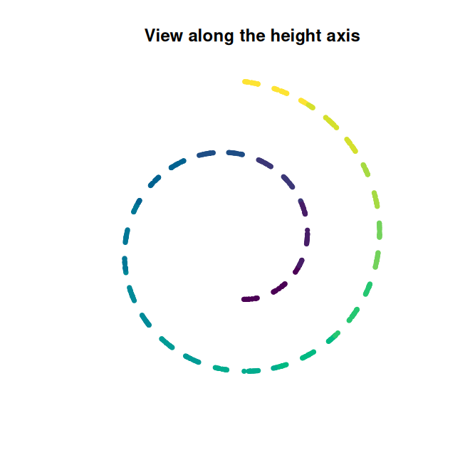
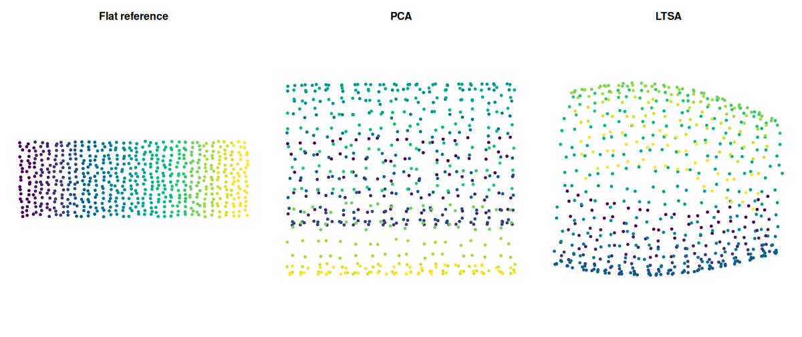
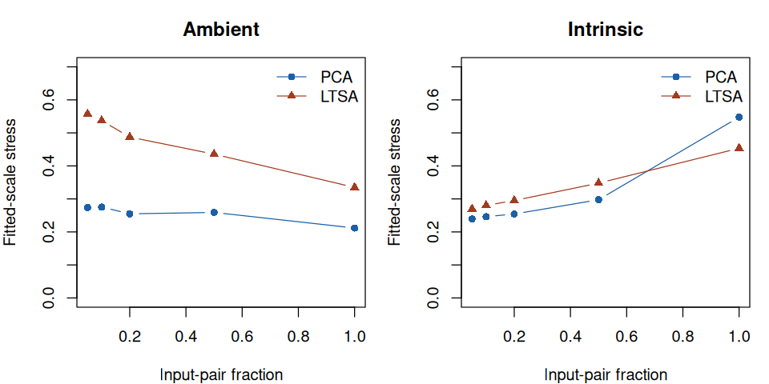
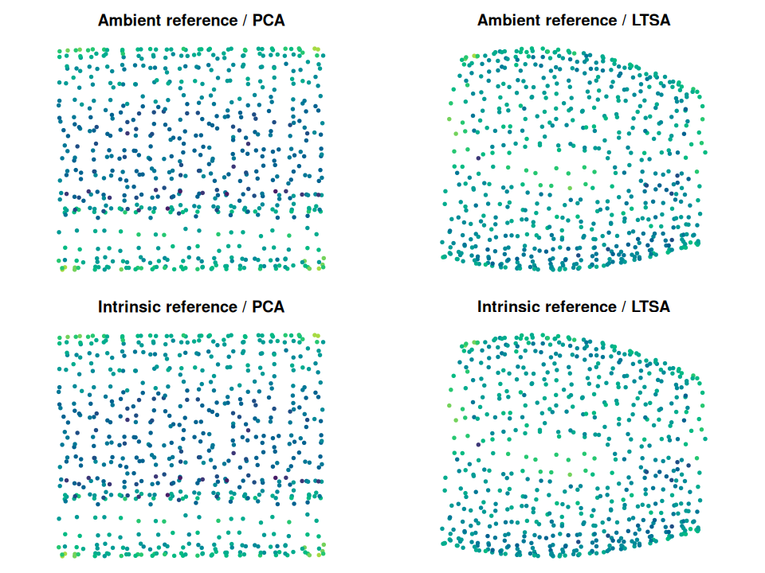
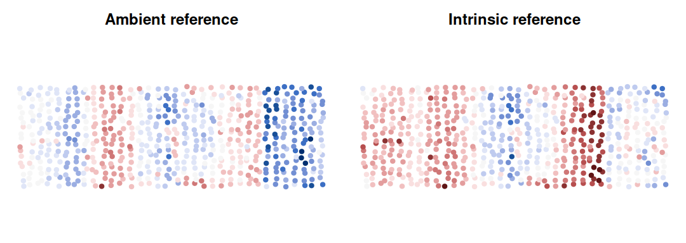
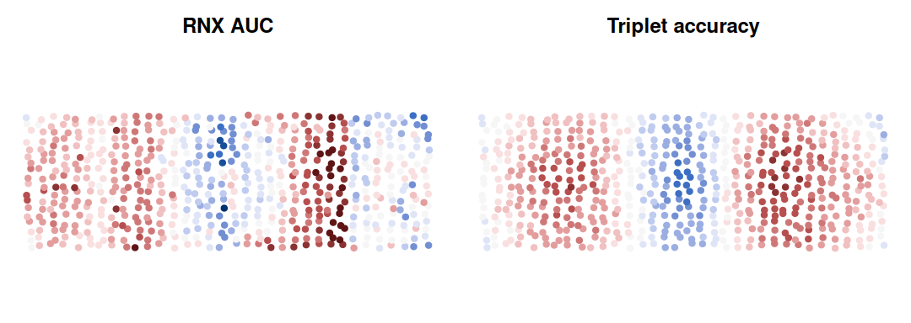

Score the same two embeddings against two references. The rolled coordinates define ambient
straight-line distances. Arc length and height define distances along the surface.

Install `quadra` from this checkout for the band profile, and install `flotsam` and `vizier`
for the fit and figures.

## Make the roll and its flat reference

```{r roll-install, eval=FALSE}
# Run once if the packages are missing:
# install.packages("pak")
# pak::pak(c("jlmelville/flotsam", "jlmelville/vizier"))
```

```{r roll-data, eval=FALSE}
library(quadra)

set.seed(63)
t_grid <- seq(1.5 * pi, 4.5 * pi, length.out = 2001)
s_grid <- (t_grid * sqrt(1 + t_grid^2) + asinh(t_grid)) / 2
grid <- expand.grid(
  s = seq(min(s_grid) + 1.5, max(s_grid) - 1.5, length.out = 34),
  h = seq(1, 29, length.out = 18)
)
n <- nrow(grid)
s <- grid$s + runif(n, -0.65, 0.65)
height <- grid$h + runif(n, -0.55, 0.55)
t <- approx(s_grid, t_grid, xout = s)$y
rolled <- cbind(t * cos(t), height, t * sin(t))
flat <- cbind(arc_length = s, height = height)
```

The same row identifies a point in every representation. The formula for `s` integrates the
speed of the spiral. Arc length and height share the original length unit. A lightly jittered
grid gives even coverage and avoids sparse patches where neighborhoods can jump between turns.

```{r roll-geometry, eval=FALSE, fig.width=5.5, fig.height=5.5}
vizier::embed_plot(
  rolled[, c(1, 3)], x = s, color_scheme = "grDevices::Viridis",
  title = "View along the height axis", fixed_aspect = TRUE, show_axes = FALSE
)
```

```{r show-roll-geometry, echo=FALSE, out.width="100%", fig.alt="A cross section shows the inner purple and outer yellow turns of the Swiss roll."}

```

## Fit PCA and LTSA

```{r roll-fit, eval=FALSE}
pca <- prcomp(rolled, rank. = 2)$x
ltsa <- flotsam::ltsa(
  rolled, n_neighbors = 15, nn_method = "exact", eig_method = "eig", output = "result"
)
c(status = ltsa$eigen$status, components = ltsa$assembly$component_count)
maps <- list(PCA = pca, LTSA = ltsa$embedding)
```

```text
    status components
      "ok"        "1"
```

```{r roll-embeddings, eval=FALSE, fig.width=10, fig.height=4.2}
par(mfrow = c(1, 3), mar = c(1, 1, 3, 1))
for (name in c("Flat reference", names(maps))) {
  xy <- c(list("Flat reference" = flat), maps)[[name]]
  vizier::embed_plot(
    xy, x = s, color_scheme = "grDevices::Viridis", title = name,
    fixed_aspect = TRUE, show_axes = FALSE, cex = 0.9
  )
}
```

```{r show-roll-embeddings, echo=FALSE, out.width="100%", fig.alt="Colors progress along the flat roll. Both embeddings mix colors, with a clearer gradient in LTSA."}

```

Color follows arc length from the inner turn (purple) to the outer turn (yellow).

## Change the reference and keep the comparisons fixed

Use every unordered pair here. For larger data, use one sample from `sample_pairs()` for both
references and both embeddings.

```{r roll-scores, eval=FALSE}
references <- list(Ambient = rolled, Intrinsic = flat)
pairs <- t(combn(n, 2))
k <- 15
compare <- function(reference, y) {
  c(
    pair_spearman = random_pair_distance_correlation(
      reference, y, pairs = pairs, method = "spearman", n_threads = 1
    ),
    neighbor_overlap = mean(nbr_pres(as.matrix(dist(reference)), as.matrix(dist(y)), k))
  )
}
results <- do.call(rbind, lapply(names(references), function(ref) {
  values <- t(vapply(maps, function(y) compare(references[[ref]], y), numeric(2)))
  data.frame(reference = ref, method = rownames(values), round(values, 3), row.names = NULL)
}))
results
```

```text
  reference method pair_spearman neighbor_overlap
1   Ambient    PCA         0.864            0.411
2   Ambient   LTSA         0.613            0.461
3 Intrinsic    PCA         0.336            0.410
4 Intrinsic   LTSA         0.590            0.459
```

PCA has the higher pair-distance correlation for the rolled coordinates. LTSA has the higher
correlation after switching to the flat reference. Both embeddings retain fewer than half
the neighbors at this `k`.

## Compare short and long distances

The fraction is defined separately for each reference. Compare PCA and LTSA *within* a reference
at each fraction, where they use the same pairs and radius.

```{r roll-bands, eval=FALSE, fig.width=8, fig.height=4}
bands <- c(0.05, 0.1, 0.2, 0.5, 1)
par(mfrow = c(1, 2), mar = c(4, 4, 3, 1))
for (ref in names(references)) {
  profiles <- lapply(maps, function(y) {
    random_pair_distance_band_profile(references[[ref]], y, bands = bands, pairs = pairs)
  })
  values <- vapply(profiles, function(z) z$normalized_stress, numeric(length(bands)))
  matplot(
    bands, values, type = "b", pch = c(16, 17), lty = 1,
    col = c("#1B60A6", "#A33B20"), ylim = c(0, 0.7),
    xlab = "Input-pair fraction", ylab = "Fitted-scale stress", main = ref
  )
  legend(
    "topright", names(profiles), col = c("#1B60A6", "#A33B20"),
    pch = c(16, 17), lty = 1, bty = "n"
  )
}
```

```{r show-roll-bands, echo=FALSE, out.width="100%", fig.alt="PCA has lower stress for every ambient band. At the full intrinsic band, LTSA has lower stress."}

```

The fitted-scale stress ranking reverses only at the full intrinsic band among these five
band sizes. The small-radius results and full-band results describe different pairs.

## Locate the lost neighbors

```{r roll-overlap, eval=FALSE, fig.width=8, fig.height=6}
par(mfrow = c(2, 2), mar = c(0.5, 0.5, 2.5, 0.5))
for (ref in names(references)) {
  din <- as.matrix(dist(references[[ref]]))
  for (method in names(maps)) {
    xy <- maps[[method]]
    overlap <- nbr_pres(din, as.matrix(dist(xy)), k)
    vizier::embed_plot(
      xy, x = overlap, color_scheme = "grDevices::Viridis", limits = c(0, 1),
      title = paste(ref, "reference /", method), fixed_aspect = TRUE,
      show_axes = FALSE, cex = 0.85
    )
  }
}
```

```{r show-roll-overlap, echo=FALSE, out.width="100%", fig.alt="Each embedding has a mixture of low and high neighbor overlap under both references."}

```

Both panels in each row use the same 0–1 scale from purple to yellow.

## Compare neighborhood agreement across sizes

For each observation, compare LTSA to PCA at `k = 15` and by RNX AUC. Both comparisons
use the same rows. Count a win only when LTSA has the higher score.

```{r roll-pointwise-rnx, eval=FALSE}
map_distances <- lapply(maps, function(y) as.matrix(dist(y)))
rnx_differences <- lapply(references, function(reference) {
  din <- as.matrix(dist(reference))
  scores <- lapply(map_distances, function(dout) pointwise_rnx(din, dout, k = k))
  cbind(rnx15 = scores$LTSA$curve[, 1] - scores$PCA$curve[, 1],
        auc = scores$LTSA$auc - scores$PCA$auc)
})
wins <- t(vapply(rnx_differences, function(d) colMeans(d > 0), numeric(2)))
round(wins, 3)
```

```text
          rnx15   auc
Ambient   0.547 0.394
Intrinsic 0.547 0.657
```

```{r roll-pointwise-rnx-plot, eval=FALSE, fig.width=9, fig.height=3.2}
limit <- max(abs(unlist(lapply(rnx_differences, function(d) d[, "auc"]))))
par(mfrow = c(1, 2), mar = c(0.5, 0.5, 2.5, 0.5))
for (ref in names(rnx_differences)) {
  vizier::embed_plot(
    flat, x = rnx_differences[[ref]][, "auc"], color_scheme = "grDevices::Blue-Red 3",
    limits = c(-limit, limit), title = paste(ref, "reference"),
    fixed_aspect = TRUE, show_axes = FALSE, cex = 1.2
  )
}
```

```{r show-roll-pointwise-rnx, echo=FALSE, out.width="100%", fig.alt="On the flat roll, PCA has higher RNX AUC in much of the outer turn using the ambient reference. LTSA leads in several regions using the intrinsic reference."}

```

At `k = 15`, LTSA has higher overlap for about 55% of points under either reference. Across
sizes, LTSA has higher AUC for about 39% of points under the ambient reference and 66% under
the intrinsic reference. The maps put both comparisons on the flat roll. Red favors LTSA,
blue favors PCA, and both panels use the same scale centered at zero.

## Check distance ordering from each anchor

Use one triplet sample for both embeddings and reference geometries. For each anchor, compare
the order of distances to the same sampled endpoints. Keep 512 comparisons per anchor to
limit sampling noise in the map.

```{r roll-anchor-triplets, eval=FALSE}
set.seed(421)
anchor_triplets <- sample_triplets(nrow(flat), n_triplets = 512)
triplet_differences <- lapply(references, function(reference) {
  scores <- lapply(maps, function(y) {
    random_triplet_accuracy(
      reference, y, triplets = anchor_triplets, by_anchor = TRUE, n_threads = 1
    )$by_anchor$accuracy
  })
  scores$LTSA - scores$PCA
})
outer <- s > min(s) + 0.8 * diff(range(s))
round(t(vapply(names(references), function(ref) {
  c(
    triplet_accuracy = mean(triplet_differences[[ref]][outer]),
    rnx_auc = mean(rnx_differences[[ref]][outer, "auc"])
  )
}, numeric(2))), 3)
```

```text
          triplet_accuracy rnx_auc
Ambient             -0.261  -0.237
Intrinsic            0.118  -0.044
```

```{r roll-anchor-triplets-plot, eval=FALSE, fig.width=9, fig.height=3.2}
scores <- list(
  "RNX AUC" = rnx_differences$Intrinsic[, "auc"],
  "Triplet accuracy" = triplet_differences$Intrinsic
)
limit <- max(abs(unlist(scores)))
par(mfrow = c(1, 2), mar = c(0.5, 0.5, 2.5, 0.5))
for (metric in names(scores)) {
  vizier::embed_plot(
    flat, x = scores[[metric]], color_scheme = "grDevices::Blue-Red 3",
    limits = c(-limit, limit), title = metric,
    fixed_aspect = TRUE, show_axes = FALSE, cex = 1.2
  )
}
```

```{r show-roll-anchor-triplets, echo=FALSE, out.width="100%", fig.alt="On the outer end of the flat roll, the triplet accuracy panel favors LTSA where much of the RNX panel favors PCA."}

```

On the outer fifth of the roll by arc length, LTSA has lower mean intrinsic RNX AUC
and retains fewer of its 15 nearest neighbors. Its mean triplet accuracy there is about
0.12 higher. The maps use the intrinsic reference and put the outer end at the right.
Red favors LTSA, blue favors PCA, and both use the same scale centered at zero.

## Compare local shape after alignment

Neighbor overlap counts retained neighbors. To look at their shape, select the 15 nearest
neighbors of each point in the flat reference and carry the same row IDs into each embedding.
Calibrate each embedding once using all pair distances, then fit rotation or reflection and
translation within each patch. This leaves patch-by-patch stretch visible.

```{r roll-shape, eval=FALSE}
original_distances <- dist(flat)
reference_dist <- as.matrix(original_distances)
diag(reference_dist) <- Inf
reference_graph <- list(idx = t(apply(reference_dist, 1, order)[seq_len(k), , drop = FALSE]))
radius <- function(d) apply(d, 1, sort)[k, ]

inspect_shape <- function(y) {
  distances <- dist(y)
  multiplier <- sum(original_distances * distances) / sum(distances^2)
  calibrated <- multiplier * y
  shape <- local_procrustes(flat, calibrated, k = k, nn_in = reference_graph, ret_extra = TRUE)
  error <- shape$pointwise_error
  i <- which.max(error)
  output_dist <- as.matrix(dist(calibrated))
  overlap <- nbr_pres(as.matrix(original_distances), output_dist, k)
  diag(output_dist) <- Inf
  c(
    row = i, patch_error = error[i], overlap = overlap[i],
    radius_ratio = unname(radius(output_dist)[i] / radius(reference_dist)[i])
  )
}
round(t(vapply(maps, inspect_shape, numeric(4))), 3)
```

```text
     row patch_error overlap radius_ratio
PCA  585       1.007   0.600        0.952
LTSA 486       1.105   0.533        0.954
```

`patch_error` divides the squared alignment residual by the reference patch's centered sum
of squares. `radius_ratio` compares the 15th-neighbor distances after calibration.

Both worst patches retain over half their neighbors and have a local radius close to the
reference. The matched coordinates still differ substantially after alignment.
